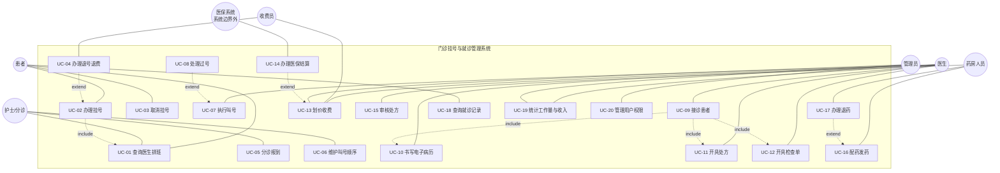
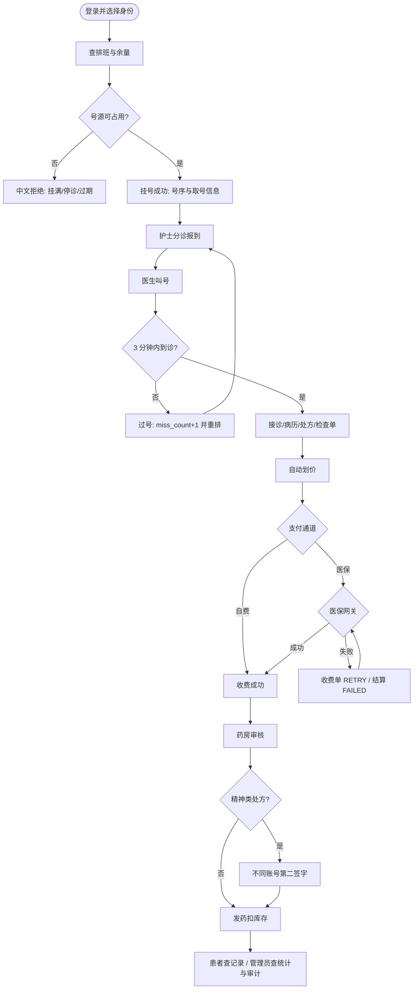
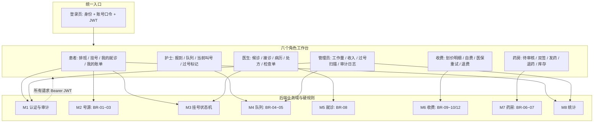
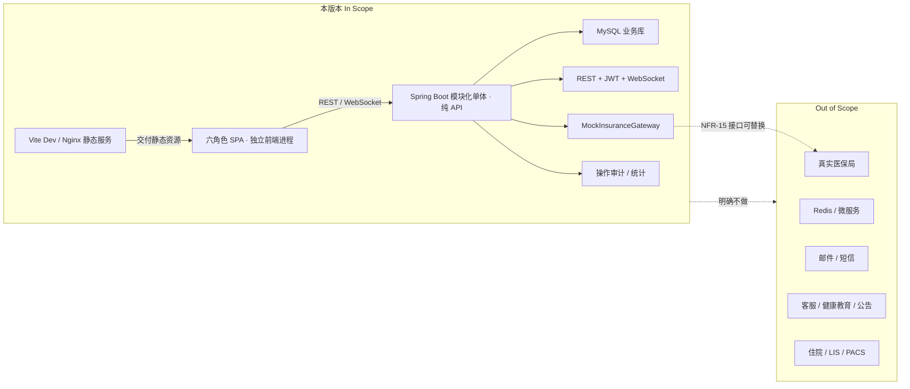

# 门诊挂号与就诊管理系统 · 产品需求文档（PRD）

| 项目 | 内容 |
| --- | --- |
| 文档编号 | PRD-OUTP-001 |
| 版本 | V1.7（基线收口、WebSocket 授权加固、审计与证据一致性） |
| 项目名称 | 门诊挂号与就诊管理系统（题目四 · 医疗健康类） |
| 作者 | 邓奕进 20243000989 |
| 评审人 | 张文文（指导老师） |
| 状态 | 待评审 |
| 变更记录 | V1.0 首次编制，内容源自《软工实验1 选题与需求描述》《软工实验2 用例图》；V1.1 补充角色用例图、用户旅程图、功能地图、范围边界图，新增 UI-01~UI-08 界面需求与 AC-19~AC-21 界面验收，并依据 GitHub 同类项目优化工作台信息组织；V1.2 依据只读实验二用例图修正 PRD-01 的参与者—用例关联、include/extend 方向和外部医保参与者位置，并补充界面验收证据索引；V1.3 明确 SPA 由独立前端工程交付、Spring Boot 只提供 REST/JWT/WebSocket；V1.4 细化取消挂号、收费员退号退费的状态前置、审计和界面口径；V1.5 把 A-01 的「管理员预先维护排班」和 UC-20 的「用户权限维护」落到管理员 REST/SPA，不改变实验报告需求范围；V1.5.1 回填 AC-24 实际执行证据；V1.5.2 明确 AC-04 的并发夹具、判定口径和清理边界，不新增功能需求；V1.5.3 新增 AC-25 全量 Mermaid 图源导出验收口径，只改变文档交付证据，不改变业务功能；V1.5.4 新增 AC-26 的 50 并发挂号 P95 验收口径与本机压测边界，不改变业务功能；V1.6 新增 AC-27 业务连通性/真实功能性审计，并明确患者队列脱敏与医生数据归属边界；V1.7 根据运行态复验新增 AC-28 WebSocket 主题授权与广播脱敏、AC-29 关键审计完整性、AC-30 文档/报告基线一致性，不新增业务模块 |

## 1. 文档目的与阅读方式

这份 PRD 是后续所有设计与编码的**唯一需求源**。三份下游文档（概要设计 SC 结构图、详细设计 SD 时序图与状态图、数据库设计说明书）必须逐条回链到本文档的需求编号，任何一处编号对不上都视为设计缺陷。

阅读顺序建议：第 3.2 节需求图 → 第 4 章功能需求 → 第 5 章业务规则 → 第 7、10 章验收标准。开发人员重点看 4.x 的「输入-处理-输出-异常」四列表格与第 10 章界面契约；评审人员重点看第 8 章范围边界。

文中所有需求编号沿用实验一的编号体系：功能需求 `FR-xx`、非功能需求 `NFR-xx`、用例 `UC-xx`（实验二 20 个用例）、业务规则 `BR-xx`（本文档新增编号，内容全部来自实验一 1.4 选题依据）。V1.1 新增的 `UI-xx` 是界面验收要求，不替代实验报告中的原始 `FR/NFR/UC` 编号。

参考开源项目只用于改善角色工作台的信息组织、登录身份选择、JWT 错误回退、叫号看板实时性和收费/异常状态可见性；开源项目中未写入实验报告的模块（客服、健康教育、公告、邮件、Redis、微服务）不进入本 PRD 范围。核对记录见《06-GitHub借鉴与选型说明.md》。

## 2. 产品定位

### 2.1 问题陈述

医院门诊部当前存在五类痛点，本系统针对它们逐一给出数字化方案：

| 编号 | 现状痛点 | 系统对策 | 对应需求 |
| --- | --- | --- | --- |
| P-01 | 挂号高峰排队时间长，号源信息不透明 | 排班与余量线上可查，线上/自助机取号 | FR-01~FR-05 |
| P-02 | 叫号与过号全靠人工喊号 | 护士分诊报到 + 医生按序叫号 + 过号自动重排 | FR-10~FR-12 |
| P-03 | 病历、处方、检查单纸质化，易丢失难共享 | 电子病历 + 处方/检查单一对多结构化存储 | FR-13~FR-18 |
| P-04 | 划价收费手工处理，效率低差错率高 | 自动划价汇总应收，收费员只录实收 | FR-19~FR-20 |
| P-05 | 医保结算手工流转繁琐 | 医保/自费分通道，与医保系统交互并回传费用 | FR-21 |

### 2.2 产品目标（可度量）

| 编号 | 目标 | 度量口径 |
| --- | --- | --- |
| G-01 | 全流程数字化 | 挂号→分诊→接诊→收费→发药 5 个环节全部在系统内闭环，无纸化 |
| G-02 | 号源零超卖 | 并发场景下同一时段挂号成功数 = 号源释放数，超出即拒绝 |
| G-03 | 结算零假成功 | 医保失败的结算不得记为已收费，必须可重试且留痕 |
| G-04 | 关键操作可追溯 | 收费、发药、医保结算、退号退费 100% 落审计日志 |
| G-05 | 敏感信息不落明文 | 手机号、身份证入库即为密文，界面默认脱敏显示 |

## 3. 用户角色与使用场景

| 角色编码 | 角色 | 核心诉求 | 高频动作 | 对应 UC |
| --- | --- | --- | --- | --- |
| PATIENT | 患者 | 少排队、知道叫到几号、看得懂费用 | 查排班、挂号、退号、查就诊记录 | UC-01~UC-04、UC-18 |
| NURSE | 护士（分诊） | 队列有序、谁没到一目了然 | 分诊报到、维护叫号顺序 | UC-05、UC-06 |
| DOCTOR | 医生 | 按号序看诊、一次开完病历和处方 | 叫号、接诊、写病历、开处方/检查单 | UC-07~UC-12 |
| CASHIER | 收费员 | 一键算清应收，医保不用手工跑 | 划价、收款、退费、医保结算 | UC-04、UC-13、UC-14 |
| PHARMACIST | 药房人员 | 没审核的方不发药，精神类要双人签 | 审核处方、签字、发药、退药、盘库存 | UC-15~UC-17 |
| ADMIN | 系统管理员 | 谁能干什么我说了算 | 用户与角色权限维护、日志审计 | UC-19、UC-20 |
| 外部系统 | 医保系统 | 收单、回传统筹与自付金额 | 结算请求/响应 | UC-14 |

### 3.1 三条主用户旅程

旅程 A（自费患者线上挂号取药）：查排班 → 选时段挂号（系统占号） → 到院分诊报到 → 等叫号 → 进诊室 → 医生写病历开 2 张处方 1 张检查单 → 收费员划价收款（自费） → 药房审核 → 发药扣库存 → 患者查就诊记录。

旅程 B（医保患者，医保系统不可用）：挂号与接诊同 A → 收费员选择医保通道 → 结算失败 → 收费单进入「待重试」，处方仍为待收费 → 医保恢复后重试成功 → 回传统筹/自付金额 → 药房审核发药。

旅程 C（过号）：医生叫 2 号 → 患者 2 号未在 3 分钟内应答 → 系统判过号 → 重排到「当前号后第 3 位」 → 护士队列刷新 → 该患者按新号序叫号 → 若仍未到，二次过号累加计数。

### 3.2 需求图（V1.1 新增，V1.2 复核）

#### 图 PRD-01 角色—用例总图（对齐实验二 20 个用例与 include/extend）

实线表示参与者与用例的关联；虚线箭头按只读实验二用例图重绘，`include` 由基础用例指向被包含用例，`extend` 由扩展用例指向基础用例。V1.2 修正了患者/护士/医生/收费员/管理员的部分关联：`UC-08` 与 `UC-14` 只通过 `extend` 进入主流程，医保系统位于系统矩形外且只关联 `UC-14`。`UC-10~12` 既是 `UC-09` 的被包含用例，也保留与医生的显式关联；`UC-19` 由医生与管理员共同触发。实验二原图没有把「鉴权与审计贯穿」画成用例关系，本图不再添加该虚线。`UC-xx` 与 FR 的逐条对应仍以《05-需求追溯矩阵.md》为准。

#### 图 PRD-02 三条主用户旅程（自费 / 医保失败重试 / 过号）

图中每个拒绝或失败节点均须显示中文业务原因，不得只显示 HTTP 状态码；医保失败分支落实 BR-10，过号分支落实 BR-04/BR-05。

#### 图 PRD-03 功能域与界面验收热区

热区判定：登录页、患者挂号、护士叫号看板、收费医保失败提示、药房双签状态、管理员审计日志为演示必查画面；其中叫号看板是主验收画面。V1.2 的截图证据见 `docs/images/00-login-desktop.png` 至 `docs/images/mobile-nurse-workspace.png`；逐项 DOM/浏览器断言见 `docs/images/ui-acceptance-report.json`，医保 FAIL 模式与 390px 六工作台动态验收见 `docs/images/dynamic-cashier-retry-after.png`、`docs/images/ui-dynamic-acceptance-report.json`。403 权限拒绝与并发抢号已由 AC-04/20/27 形成脚本证据；WebSocket 断线后的 15 秒轮询交互仍列为待补，主题授权与广播内容按 V1.7 AC-28 单独验收。

#### 图 PRD-04 范围边界与可替换外部接口

外部系统只通过 `InsuranceGateway` 契约接入；`NORMAL / FAIL / TIMEOUT` 是本地 Mock 的演示模式，不代表真实医保局接口能力。V1.3 前后端分离只影响交付拓扑：SPA 独立运行在 Vite/Nginx，后端只提供 REST/JWT/WebSocket，不新增业务功能；详细端口与代理见《07-前后端分离架构与部署说明.md》。

## 4. 功能需求

每条需求给出：优先级（P0 必须实现 / P1 应当实现 / P2 可延后）、验收要点、异常流。异常流编号 `E-xx` 在测试用例设计中直接引用。

### 4.1 M2 排班与号源管理

| 编号 | 需求描述 | 优先级 | 验收要点 |
| --- | --- | --- | --- |
| FR-01 | 患者可按日期、科室、医生查询排班；管理员可在管理台维护开放号源 | P0 | 患者列表显示「剩余 x / 总量 y」；管理员创建/调整/停诊排班后，患者端刷新可见，且已占用号源不允许被调到小于占用量 |
| FR-02 | 同一医生同一时段号源数量有限，挂满即停 | P0 | 余量为 0 时提交挂号必须被拒绝，且不产生挂号单 |
| FR-03 | 退号后号源自动释放回号池 | P0 | 退号成功后 `remaining_qty` 加 1，且可被他人重新挂取 |
| FR-04 | 号源支持并发占用与释放，同一号源并发下只成功一次 | P0 | 20 人并发抢 15 个号，成功数必须恰为 15，失败提示「号源已被占完」 |

异常流：
- E-01 排班已停诊（状态 CLOSED）仍被提交挂号 → 拒绝并提示「该时段已停诊」。
- E-02 出诊日期早于当天 → 拒绝并提示「排班已过期」。

### 4.2 M3 挂号管理

| 编号 | 需求描述 | 优先级 | 验收要点 |
| --- | --- | --- | --- |
| FR-05 | 支持线上与自助机两种渠道挂号取号，挂号成功返回号序与取号信息 | P0 | 挂号单含号序、医生、科室、时段、费用；号序在同一号源内唯一且递增 |
| FR-06 | 支持患者本人取消挂号（未报到、未就诊前） | P0 | 状态置为 CANCELLED，同时释放号源；写审计日志；仅患者本人可操作 |
| FR-07 | 支持退号退费（由收费员办理） | P0 | 已报到但未就诊的挂号单可退号；释放号源 + 生成挂号费退费记录 + 写审计日志，退费金额等于挂号费 |
| FR-08 | 挂号单状态可跟踪：已挂号/已报到/叫号中/已就诊/已过号/已取消/已退号 | P0 | 状态变更全部留痕，非法跃迁被拒绝 |
| FR-09 | 患者可查询本人就诊记录 | P0 | 只能查到自己的记录，越权访问返回 403 |

异常流：
- E-03 已就诊（VISITED）或已过号（MISSED）的挂号单申请退号 → 拒绝（对应实验一 UC-01 的 5a）。
- E-04 同一患者对同一号源重复挂号 → 拒绝并提示已存在的挂号单。

V1.4 口径：患者取消只接受 `REGISTERED` 且尚未分诊报到、尚未产生就诊记录的本人挂号单；收费员退号接受 `REGISTERED / TRIAGED / CALLING`，但拒绝 `VISITED / MISSED / CANCELLED / REFUNDED`。两种操作都在同一事务内回补号源余量，状态置终态并写审计；`REFUNDED` 退号另插入 `refund_record(type=REGISTRATION)`。已收费挂号费随收费单整单退费时，不能对同一挂号单重复生成挂号费退费记录；该复合流程列为后续增强，当前可验收路径是取消/退号与收费单整单退费分别处理。界面入口必须放在患者「我的挂号」与收费台挂号列表中，且服务端按 JWT 角色和数据归属二次校验。

V1.5 管理维护口径：角色维护支持按编码查询、新建和修改名称/权限清单，不提供删除已被引用的角色；登录账号维护支持新建、编辑姓名/角色/业务档案关联、重置口令、启用/禁用，禁止删除已产生业务数据的账号，且不允许禁用当前登录管理员。口令只允许写入 PBKDF2 哈希，REST 与界面均不回传哈希；患者/医生类账号的 `refId` 必须指向有效档案。排班维护支持按医生、科室、日期、时段新增/编辑/停诊，创建时 `remaining_qty=total_qty`，编辑总量时按已占用数量同步修正余量，禁止把总量调低到已占用量以下；同一医生同一日期同一时段仍由 `uk_schedule_slot` 保证唯一。所有维护动作写 `operation_log`，独立 SPA 只提交表单、不本地裁定业务权限。

### 4.3 M4 分诊叫号

| 编号 | 需求描述 | 优先级 | 验收要点 |
| --- | --- | --- | --- |
| FR-10 | 护士完成分诊报到并维护叫号顺序 | P0 | 报到后状态 REGISTERED→TRIAGED，护士可手工调整队列次序 |
| FR-11 | 医生按号序叫号，患者到诊室就诊 | P0 | 叫号取队首（call_order 最小）；未到诊室的患者不能开始就诊 |
| FR-12 | 叫号后 3 分钟未到诊室判过号，重新排队并插到当前号后第 3 位 | P0 | 定时任务自动判定；重排后队列次序与「当前号+3」一致，末位不足时排到队尾 |

异常流：
- E-05 未报到的患者被叫号 → 拒绝（只能叫 TRIAGED 状态）。
- E-06 过号重排时目标位置超出队列长度 → 排到队尾并提示。
- E-07 患者已到诊室后又收到超时判定 → 已到诊（arrived_at 非空）的患者不参与过号扫描。

### 4.4 M5 就诊诊断

| 编号 | 需求描述 | 优先级 | 验收要点 |
| --- | --- | --- | --- |
| FR-13 | 医生接诊后可查看患者基本信息 | P0 | 手机号/身份证按角色脱敏或解密展示 |
| FR-14 | 医生书写电子病历（主诉、诊断、医嘱） | P0 | 一次就诊一份病历，支持修改与删除（FR-18） |
| FR-15 | 医生开具处方（药品 + 数量 + 用法用量） | P0 | 金额按药品当前单价快照计算 |
| FR-16 | 医生开具检查单（检查项目） | P0 | 项目来自检查字典，价格快照写入检查单 |
| FR-17 | 一次就诊可开多张处方、多张检查单（一对多） | P0 | 同一 visit_id 下多条处方/检查单记录 |
| FR-18 | 就诊记录与病历支持增删改查 | P0 | 已发药的处方不可删除；已完成就诊不可再改病历（可另开新病历版本，本系统采用「完成后禁止修改」口径） |

异常流：
- E-08 处方药品库存不足 → 拒绝保存并提示医生调整（对应 UC-03 的 4a）。
- E-09 保存中途失败 → 事务回滚，不产生残缺病历或半张处方（对应 UC-03 的 5a）。

### 4.5 M6 划价收费

| 编号 | 需求描述 | 优先级 | 验收要点 |
| --- | --- | --- | --- |
| FR-19 | 按处方与检查单自动划价计价 | P0 | 收费明细逐项列出来源单据，合计等于应收金额 |
| FR-20 | 自动汇总应收，收费员收款并录实收 | P0 | 实收 < 应收时拒绝（对应 UC-04 的 4a） |
| FR-21 | 医保与自费分通道，医保需与外部系统交互并回传费用 | P0 | 医保通道下记录统筹与自付拆分；失败进入待重试 |
| FR-22 | 支持办理退费 | P0 | 生成退费记录，收费单状态 REFUNDED，写日志 |
| FR-23 | 按收费员/患者查询收费明细，提供门诊收入统计 | P0 | 支持时间段过滤，统计口径为已收费金额 |

异常流：
- E-10 医保系统不可用 → 保留待重试状态，绝不写成功记录（对应 UC-04 的 3a）。
- E-11 同一就诊重复划价 → 已存在未收费单时直接返回原单，不重复生成。

### 4.6 M7 药房管理

| 编号 | 需求描述 | 优先级 | 验收要点 |
| --- | --- | --- | --- |
| FR-24 | 处方必须经药房审核通过后方可发药 | P0 | 未审核（PAID）状态直接发药被拒绝 |
| FR-25 | 精神类药品需双人签字确认后方可发药 | P0 | 第一签字人与第二签字人不得为同一账号 |
| FR-26 | 配药发药后自动扣减库存 | P0 | 扣减走条件更新，库存不足则整体回滚 |
| FR-27 | 支持办理退药并回补库存 | P0 | 退药后处方状态 RETURNED，生成退药流水 |
| FR-28 | 药品库存查询与更新 | P0 | 支持名称/编码检索，展示低限、高限、近效期预警 |

异常流：
- E-12 审核不通过 → 处方退回，状态保持 PAID 并可作废（CANCELLED）。
- E-13 精神类处方缺少第二签字 → 禁止发药并提示（对应 UC-05 的 2a）。
- E-14 发药时库存不足 → 中止发药并回滚（对应 UC-05 的 3a）。

### 4.7 M8 查询统计

| 编号 | 需求描述 | 优先级 | 验收要点 |
| --- | --- | --- | --- |
| FR-29 | 按病历号、姓名查询患者就诊历史 | P0 | 结果含诊断、处方、收费、发药四段信息 |
| FR-30 | 医生工作量统计与门诊收入统计（时间段、收费员） | P1 | 工作量=接诊人次；收入=已收金额，医保与自费分列 |

### 4.8 M1 用户与权限

| 编号 | 需求描述 | 优先级 | 验收要点 |
| --- | --- | --- | --- |
| FR-31 | 登录验证，不同角色不同操作权限；管理员可维护角色目录与登录账号 | P0 | 未登录访问接口返回 401；角色不符返回 403；新建/编辑账号后可按新口令登录，禁用账号立即不能登录，角色与权限变更写审计 |
| FR-32 | 收费、发药、医保结算等关键操作记录日志 | P0 | 日志含操作人、角色、动作、对象、时间、结果 |

## 5. 业务规则（硬约束）

规则编号 `BR-xx` 是测试用例与验收的直接依据，全部来自实验一 1.4 选题依据。

| 编号 | 规则 | 强度 | 落地位置 | 验证方式 |
| --- | --- | --- | --- | --- |
| BR-01 | 同一医生同一时段号源数量受限，挂满即停 | 强制 | 号源占用条件更新 | FR-02/FR-04 并发测试 |
| BR-02 | 取消或退号后号源释放回号池 | 强制 | 取消/退号事务内回补余量，且一次挂号只回补一次 | FR-03/FR-06/FR-07 |
| BR-03 | 同一号源在并发下只能被成功占用一次 | 强制 | 行锁（SELECT FOR UPDATE）+ 号序唯一约束 | 20 并发抢 15 号 |
| BR-04 | 叫号后 3 分钟未到诊室判过号 | 强制 | 过号扫描定时任务 | FR-12 |
| BR-05 | 过号重排插入当前号后第 3 位 | 强制 | 队列重排算法 | FR-12 + 状态图 |
| BR-06 | 处方未审核不得发药 | 强制 | 处方状态机 | FR-24 |
| BR-07 | 精神类药品发药需双人签字 | 强制 | 发药前置校验 | FR-25 |
| BR-08 | 一次就诊对应多张处方、多张检查单 | 强制 | 一对多外键 | FR-17 |
| BR-09 | 医保结算记录必须与收费单对应 | 强制 | 结算表外键 | FR-21 |
| BR-10 | 医保失败不得记为已收费 | 强制 | 结算失败分支 | FR-21/E-10 |
| BR-11 | 已就诊、已过号或终态挂号单不可取消/退号 | 强制 | 取消/退号前置状态校验 | FR-06/FR-07/E-03 |
| BR-12 | 实收金额小于应收金额拒绝收款 | 强制 | 收款校验 | FR-20 |

## 6. 非功能需求

| 编号 | 类别 | 指标 | 验证方法 |
| --- | --- | --- | --- |
| NFR-01 | 性能 | 挂号、收费关键响应 ≤ 3 秒 | 压测脚本 50 并发取 P95；V1.5.4 先覆盖挂号接口，收费接口全链路压测仍为边界 |
| NFR-02 | 并发一致性 | 号源零超卖 | BR-03 并发用例 |
| NFR-03 | 性能 | 查询类响应 ≤ 5 秒 | 造 10 万挂号单后测 |
| NFR-04 | 安全 | 未认证不可访问任何业务接口 | 401 用例 |
| NFR-05 | 安全 | 角色权限最小化 | 逐接口 403 用例 |
| NFR-06 | 安全 | 手机号/身份证存储与传输加密 | 查库确认无明文 |
| NFR-07 | 审计 | 关键操作 100% 日志 | 日志覆盖率检查 |
| NFR-08 | 完整性 | 每表主键约束 | DDL 审查 |
| NFR-09 | 完整性 | 外键约束全覆盖 | DDL 审查 |
| NFR-10 | 完整性 | 业务规则入库（CHECK/UNIQUE） | DDL 审查 |
| NFR-11 | 可靠性 | 定期备份与恢复 | 部署文档脚本 |
| NFR-12 | 可靠性 | 关键操作事务性 | 异常注入回滚用例 |
| NFR-13 | 易用性 | 培训后 30 分钟内独立完成全流程 | 用户试用记录 |
| NFR-14 | 可维护性 | 模块低耦合高内聚 | 依赖矩阵审查 |
| NFR-15 | 可扩展性 | 外部系统以接口对接 | 医保网关可替换验证 |

## 7. 验收标准（Given-When-Then）

| 编号 | 关联需求 | 场景 |
| --- | --- | --- |
| AC-01 | FR-01 | Given 医生张明明天上午有 25 个号源 When 患者查询排班 Then 看到剩余 25 与挂号费 25 元 |
| AC-02 | FR-02/BR-01 | Given 某时段余量为 0 When 患者提交挂号 Then 返回「号源已挂满」且不生成挂号单 |
| AC-03 | FR-03/FR-07/BR-02 | Given 患者持有已报到但未就诊的挂号单 When 收费员办理退号 Then 号源余量 +1、挂号单为 REFUNDED 且生成 `REGISTRATION` 退费记录与审计日志 |
| AC-04 | FR-04/BR-03 | Given 临时开放号源恰有 15 个余量 When 20 个独立患者在同一时刻经 REST 并发挂号 Then 成功恰好 15 次、号序为 1~15 且不重复、最终余量为 0，其余 5 次收到中文业务拒绝且不产生脏数据；验收后清理临时夹具 |
| AC-05 | FR-05 | Given 患者选择某号源 When 挂号成功 Then 返回号序、取号时间、医生、科室 |
| AC-06 | FR-06/FR-08/BR-11 | Given 挂号单状态为 VISITED 或 CANCELLED When 患者取消或收费员退号 Then 拒绝；Given REGISTERED 挂号单 When 患者取消 Then 号源余量 +1 且状态为 CANCELLED |
| AC-07 | FR-12/BR-05 | Given 医生正在叫 5 号，10 号已过号 When 过号判定生效 Then 10 号被重排到第 8 号位置 |
| AC-08 | FR-17/BR-08 | Given 一次就诊 When 医生开 2 张处方 3 张检查单 Then 数据表内该 visit_id 关联 2 条处方、3 条检查单 |
| AC-09 | FR-19/FR-20 | Given 处方与检查单待收费 When 划价 Then 明细逐条列出且合计等于应收 |
| AC-10 | FR-21/BR-10 | Given 医保系统设为不可用 When 收费员走医保通道 Then 结算记录 FAILED，收费单为 RETRY，处方仍为待收费 |
| AC-11 | FR-24/BR-06 | Given 处方已收费未审核 When 药房发药 Then 拒绝并提示先审核 |
| AC-12 | FR-25/BR-07 | Given 精神类处方仅一人签字 When 发药 Then 拒绝并要求第二签字 |
| AC-13 | FR-26 | Given 库存 20 When 发药 30 Then 中止并回滚，库存仍为 20 |
| AC-14 | FR-27 | Given 处方已发药 When 办理退药 Then 库存回补且处方状态 RETURNED |
| AC-15 | FR-31 | Given 未登录 When 调用任意业务接口 Then 返回 401 |
| AC-16 | FR-32 | Given 收费成功 When 查询审计日志 Then 存在 CHARGE_PAY 记录并含金额 |
| AC-17 | NFR-06 | Given 患者入库 When 直接查库 When 查看 phone_enc 字段 Then 值为 ENC:v1: 前缀密文 |
| AC-18 | NFR-12 | Given 处方明细保存中途抛异常 When 事务提交 Then 处方与明细均不残留 |
| AC-19 | UI-01/UI-02/NFR-13 | Given 未登录用户打开首页 When 选择身份并输入演示账号口令 Then 进入该角色工作台，后续业务请求均带 Bearer JWT；Given token 失效 When 请求业务接口 Then 清理本地会话并回到登录页 |
| AC-20 | UI-03/UI-04/UI-05 | Given 护士打开叫号看板 When 队列发生变化 Then 当前号、候诊队列、过号标记与状态标签可读；Given 医保 FAIL 模式 When 收费 Then 页面显示「待重试」及中文原因，不显示收费成功 |
| AC-21 | UI-06/UI-07/UI-08 | Given 桌面或移动端宽度 When 打开六个工作台 Then 主要操作无需横向滚动即可完成，金额显示两位小数并带「元」，所有业务拒绝均显示中文原因 |
| AC-22 | UI-01/UI-02/NFR-14 | Given 前端与后端分别启动 When 浏览器访问独立 SPA Then 业务请求经 `/api` 代理或配置后的绝对 API 地址到达 Spring Boot，且 Spring Boot 根路径不再返回业务 HTML；Given 独立部署前端 When 配置 CORS/WS 白名单 Then 登录、REST 与 STOMP 均可用 |
| AC-23 | FR-06/FR-07/NFR-04/05/07/12 | Given 患者或收费员分别登录独立 SPA When 对合法挂号单取消/退号 Then 状态、号源余量、退费记录与审计日志在同一事务后一致；Given 越权用户或终态挂号单 When 调同一端点 Then 返回中文拒绝且数据不变 |
| AC-24 | FR-01/FR-31/UC-20/NFR-04/05/07 | Given 管理员登录独立 SPA When 新建或修改角色/账号/排班 Then 变更经 ADMIN 专属 REST 写入数据库并产生审计；Given 非管理员或无效参数 When 调同一端点 Then 返回中文拒绝且不产生脏数据；Given 新建账号与开放排班 When 患者重新登录查询 Then 可登录并看到新号源 |
| AC-25 | NFR-13/NFR-14、实验三/四/五/八图示交付 | Given 8 份设计文档中的全部 33 个 Mermaid 图源 When 执行 `npm run check:diagrams` Then 每张图生成一份 SVG 与一份 PNG，文件均非空且可被浏览器解析；生成图集索引记录图号、标题、源文件、源行号与两种导出路径，机器报告 `passed=true`；图源与导出图语义一致，不把导出行为表述为业务功能新增 |
| AC-26 | NFR-01/02/03、BR-03、G-07 | Given 本机 Spring Boot 8080 与 MySQL 可用 When 执行 `npm run check:perf` Then 3 轮各由 50 个独立患者账号经屏障同时提交同一 50 容量号源的挂号请求，单轮与汇总的 P95 均 ≤ 3000ms；每轮成功恰好 50 次、号序 1~50 不重复、最终余量 0、无 5xx/脏数据，报告 `passed=true` 且临时夹具零残留。该验收是本机正确性 + 延迟证据，不等同 10 万数据压测、收费接口压测或生产容量结论 |
| AC-28 | NFR-04/05、FR-10/11、UI-04、SE-06 | Given 主后端与独立 SPA 运行 When 执行 `npm run check:ws` Then 患者只能订阅本人对应的 `/topic/queue/{doctorId}/{workDate}/masked/{patientId}` 专属主题；手工订阅员工完整主题或其他患者专属主题均被 STOMP ERROR 拒绝；员工完整主题仅 ADMIN/NURSE/本人医生可订阅；真实报到广播后，患者专属主题只保留本人身份，其他候诊者 `patientId/patientNo/patientName` 为空，员工主题保留完整身份；机器报告 `ws-authorization-report.json` 为 `passed=true`，临时夹具零残留 |
| AC-29 | NFR-04/07、FR-02/05/10/11、BR-11 | Given 患者挂号、护士报到、收费员划价、医生到诊和定时过号扫描分别发生 When 执行 `npm run check:audit` Then 对应 `operation_log` 记录具备明确操作人或 SYSTEM 身份、动作、目标 ID 与时间；挂号成功写入 `REGISTRATION_BOOK`；审计由业务事务登记、在外层切面完成事务资源释放后以 `REQUIRES_NEW` 独立事务同步落库，SD/RTM 不表述为同事务原子一致 |
| AC-30 | NFR-14、文档基线一致性 | Given V1.7 代码与脚本交付 When 执行 `npm run check:docs` Then 设计文档、README、图集索引、报告基线字段不含「已交付功能沿用未实现表述」「核心 Mermaid 图数沿用旧数字」「已通过 50 并发压测却沿用未完成表述」「PRD 版本号沿用 1.5.2 段旧值」「DM8 未提供脚本却写成已交付」等陈旧口径；当前版本基线均为 V1.7；`docs-baseline-report.json` 为 `passed=true` |
| AC-27 | NFR-04/05、FR-09/10/11/30、UI-04 | Given 独立 SPA 5173、Spring Boot 8080 与 MySQL 均运行 When 执行 `npm run check:connectivity` Then Vite 代理登录成功，六角色主要工作台端点均返回 `code=0`；患者读取他人收费单/就诊/处方、未挂号队列和其他医生队列均返回 `code=403`；患者队列仅保留本人身份、其他候诊者脱敏；医生只能确认自己队列并查看自己的工作量；管理员仍可读取收费单详情。机器报告 `read-only-connectivity-report.json` 为 `passed=true`，不产生业务写数据 |

## 8. 范围界定

### 8.1 本版本包含（In Scope）

排班号源、挂号与退号、分诊叫号与过号、电子病历、处方与检查单、划价收费、医保结算（外部系统以可替换接口 + 模拟实现交付）、药房审核发药与退药、库存查询与预警、就诊历史与两类统计、登录与角色权限、关键操作审计日志。

### 8.2 本版本不做（Out of Scope）

- 真实医保局接口联调（仅按标准接口契约实现模拟网关，切换真实地址为配置项）。
- 药品供应商采购入库对账（沿用数据库课程设计的库存基线，只做库存查询与更新）。
- 住院、体检、检验报告 LIS 对接、影像 PACS 对接。
- 移动支付渠道对账、发票打印。
- 多院区、多租户与号源跨院转诊。

### 8.3 依赖与假设

- 假设 A-01：门诊日排班由管理员在本系统管理台预先维护，本系统不做智能排班；V1.5 前该动作仅由 SQL 初始化，现已提供管理员 API 与界面。
- 假设 A-02：叫号后的「3 分钟」由系统时间判定，不接入硬件叫号屏语音。
- 依赖 D-01：医保系统提供结算与状态查询两个接口（本系统以 `InsuranceGateway` 契约封装）。
- 依赖 D-02：数据库服务器可用，连接参数在 `application.yml` 中配置。

## 9. 数据需求概览

核心实体 17 个（沿用实验三类图），关系见《数据库设计说明书》。关键数据量基线：科室 5、医生 5、患者 8、药品 12、检查项目 8、号源 10、挂号单 6（演示基线）。查询统计模块要求就诊历史、收费明细可追溯到单据级。

## 10. 界面与交互要求（V1.1 细化，V1.2 验收回填）

界面需求编号 `UI-xx` 只约束交付软件的呈现和交互，不新增实验报告之外的业务功能。界面参考 GitHub 项目的「按角色分工作台、登录身份可辨、队列实时可见、异常状态单独成区」做法，不引入客服、公告、邮件等范围外模块。

| 编号 | 界面要求 | 验收画面/交互 | 关联需求 |
| --- | --- | --- | --- |
| UI-01 | 单页统一入口，登录时可见角色/身份、真实姓名与当前工作区；JWT 仅保存在本机会话，退出即清除 | 登录页与顶栏 | FR-31、NFR-04、NFR-05 |
| UI-02 | 所有 REST 请求自动携带 `Authorization: Bearer <token>`；以统一响应体的 `code=0` 判定成功；`code=401` 回登录，`code=403` 显示权限不足 | 任一工作台触发权限边界 | FR-31、NFR-04、NFR-05 |
| UI-03 | 六个工作台：患者、护士、医生、收费员、药房、管理员；只展示当前角色可操作的动作，避免用隐藏按钮冒充权限控制；患者台提供本人取消挂号，收费台提供挂号单退号入口，管理台提供角色/账号/排班维护 | 登录后导航、我的挂号、收费与退费、管理维护 | FR-01、FR-06、FR-07、FR-31、NFR-13 |
| UI-04 | 护士叫号看板突出「当前叫号 + 候诊队列 + 过号次数标记」；支持 `GET /api/queue/board` 全量刷新和 WebSocket `/topic/queue/{doctorId}/{workDate}` 员工主题、`/topic/queue/{doctorId}/{workDate}/masked/{patientId}` 患者专属脱敏主题，连接不可用时自动降级为轮询；患者端只显示本人姓名/病历号，其他候诊者显示队列进度；服务端拒绝患者订阅员工完整主题或其他患者专属主题 | 叫号看板 | FR-10~FR-12、BR-04/BR-05、NFR-04/05 |
| UI-05 | 收费台明确区分 `UNPAID / PAID / RETRY / REFUNDED`；医保失败卡片显示失败原因、重试次数与「重新结算」入口；精神类处方在药房台显示双签状态 | 收费台、药房台 | FR-21、FR-24~FR-25、BR-07/BR-10 |
| UI-06 | 金额一律两位小数并带「元」，时间统一 `yyyy-MM-dd HH:mm:ss`，状态使用中文标签而不是原始英文码 | 列表、卡片、明细 | NFR-13 |
| UI-07 | 所有拒绝操作给出中文原因；服务端返回 `code != 0` 时禁止把操作误显示为成功；空列表与加载中分别提示 | 全部表单与列表 | E-01~E-14、NFR-13 |
| UI-08 | 桌面与移动端均可用；导航可折叠，叫号大字在小屏保持可读，表格在窄屏转为卡片或可滚动区域 | 390px 与 1440px 宽度 | NFR-13 |

界面设计约束：采用「门诊导视 + 临床仪表盘」视觉语言，使用有辨识度的中文字体栈、冷暖对比色和轻微纹理背景；避免紫白渐变、默认系统字体和千篇一律的卡片仪表盘。入场动画只用于页面首屏和工作台列表错峰出现，状态变化使用短促且不遮挡内容的反馈。

前端与后端的协议约定：统一响应为 `{code,message,data}`；业务 403/404/409/502 和 Spring Security 的 401/403 当前可能使用 HTTP 200 + 非零 `code`，前端必须优先读取 `code`，不得只判断 HTTP status。V1.3 起静态资源由独立前端进程公开，Spring Boot 仅公开登录/角色目录与 `/error`，业务接口仍全部鉴权。开发时 `/api`、`/ws` 由 Vite 同源代理；独立部署时按 07 文档配置绝对地址或反向代理及 CORS/WS 白名单。

V1.2 浏览器验收基线：以 Edge/Chromium CDP 在 `1440×1000` 桌面宽度和 `390×844` 移动宽度检查登录页、真实表单登录、失效 token 回登录、六角色工作台、移动端护士台；断言工作台 DOM、无横向溢出、金额两位小数且带「元」、状态中文标签、时间 `yyyy-MM-dd` 格式、STOMP 连接状态以及无 JS exception / error-warning 日志。动态验收另在 `app.insurance.mode=FAIL` 下把收费单重置为 `UNPAID` 后实际点击医保结算，验证新增唯一 FAILED 流水、收费单保持 `RETRY`、显示「结算失败」与中文原因、提供「重新结算」且不显示已收费；并在 390px 下逐一加载六个工作台。V1.3 起这些验收在独立前端 5173/5174 上重跑并通过；证据目录为 `docs/images/`，机器可读结果为 `ui-acceptance-report.json`、`ui-dynamic-acceptance-report.json` 与 `frontend-split-acceptance-report.json`。V1.4 的取消/退号事务、403 越权与 409 终态重复验收 AC-23 已由 `scripts/registration-cancel-refund-check.mjs` 执行 PASS，报告为 `registration-cancel-refund-report.json`。V1.5 的 AC-24 已由 `scripts/admin-maintenance-check.mjs` 执行 PASS，报告为 `admin-maintenance-report.json`，覆盖管理台 1440px/390px 表单与列表、ADMIN 专属拒绝、PBKDF2 哈希、重置口令、禁用登录、容量与停诊、审计和演示数据清理；截图为 `admin-maintenance-desktop.png`、`admin-maintenance-forms-desktop.png`、`admin-maintenance-schedules-desktop.png`、`admin-maintenance-mobile.png`、`admin-maintenance-forms-mobile.png`。V1.5.2 起 AC-04 由 `scripts/concurrency-acceptance.mjs` 用独立夹具实测，结果写入 `concurrency-acceptance-report.json`；V1.5.4 起 AC-26 由 `scripts/perf-50-concurrency.mjs` 用 3 轮 50 并发本机压测，结果写入 `perf-50-concurrency-report.json`。验收脚本只创建临时患者、账号、号源与挂号，结束时清理。上述证据不替代断线轮询降级、其余端点 403 全量清单、收费接口压测与 10 万数据量压测。

V1.5.3 图集交付口径：PRD/SC/SD 的 30 张主设计图作为历史范围说明，连同 DBD 的 ER 图、DEP 的 2 张部署拓扑图一并纳入 `check:diagrams`；`check:mermaid` 同步扩展为全量 33 张解析。导出图放在 `docs/images/diagrams/`，索引与机器报告分别见 `docs/images/diagrams/图集索引.md`、`docs/images/mermaid-export-report.json`。2026-11-05 实际执行 `check:mermaid` 为 33/33 解析 PASS，`check:diagrams` 为 33 份 SVG + 33 份 PNG、`passed=true`；结果已回填 `docs/09-图集导出与演示记录.md` 与 RTM。

V1.7 性能验收口径：`docs/10-50并发性能压测说明.md` 规定 AC-26 的本机夹具、3 轮采样、P95 计算、正确性断言、清理和解释边界。2026-11-06 实际执行 `npm run check:perf` 为 PASS：3 轮共 150 次挂号全部成功，单轮 P95 705/549/525ms，汇总 P95 642ms、P99 719ms、最大 732ms，均低于 3000ms；每轮号序 1~50、余量 0、无 5xx，临时夹具零残留。机器报告为 `docs/images/perf-50-concurrency-report.json`。10 万挂号单数据量、收费接口、真实广域网 RTT、冷启动与生产容量规划不因本次压测改写为已交付。

V1.7 运行态收口：

2026-11-06 服务启动后审查发现患者可手工订阅员工完整主题、masked 广播连本人身份也清空、挂号成功未写审计、动态 UI 四个移动端启动遮罩断言不稳定、参数名错误返回 500 等问题。V1.7 修复范围限定为：服务端 WebSocket 主题白名单与患者专属脱敏、关键操作审计人透传、动态遮罩等待条件、缺失参数 400 映射、文档与报告基线一致性；不新增价格版本、批次库存锁、幂等键、真实医保联调或生产化部署。检查结果见 `docs/20261106-203106-运行服务后审查与复验结果.md`，验收证据新增 `ws-authorization-report.json`、`audit-integrity-report.json` 与 `docs-baseline-report.json`。

V1.6 连通性与数据归属验收口径：`scripts/read-only-connectivity-audit.mjs` 通过 Vite 代理和后端 REST 实测登录、六角色主要工作台、统计/审计接口与典型越权边界，并用 MySQL 只读核对演示单据归属。2026-11-05 实际执行 `npm run check:connectivity` 为 PASS：全部矩阵端点 `code=0`；患者读取他人收费单、未挂号队列、其他医生队列，以及医生确认他人队列均返回 `code=403`；患者队列中其他候诊者的 `patientId/patientNo/patientName` 为空；医生工作量只包含本人；管理员收费单详情可读。机器报告为 `docs/images/read-only-connectivity-report.json`。该审计不等于全量渗透测试，也不覆盖断网轮询降级的浏览器交互实测。

## 11. 需求追溯约定

`FR → UC → 模块（SC 图）→ 接口 → 类/表 → 测试用例` 六段链条必须可双向检索。追溯矩阵由《05-需求追溯矩阵.md》维护，代码提交说明需引用 FR 或 BR 编号，否则视为不可追溯变更。

