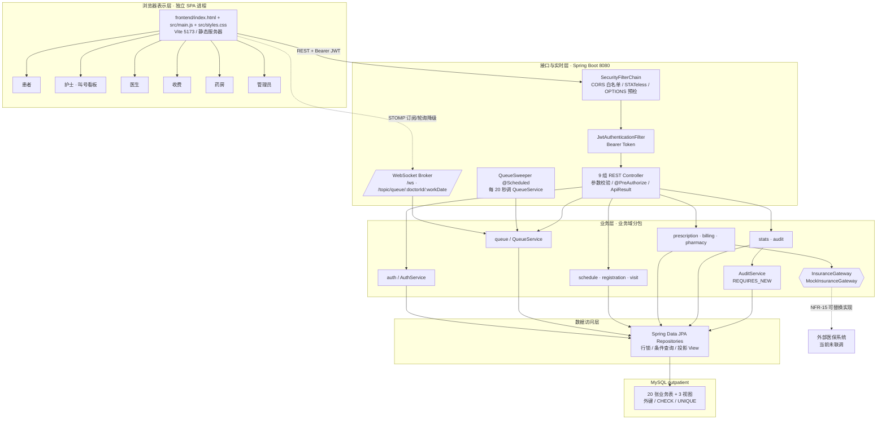
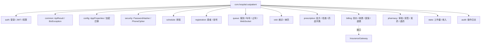
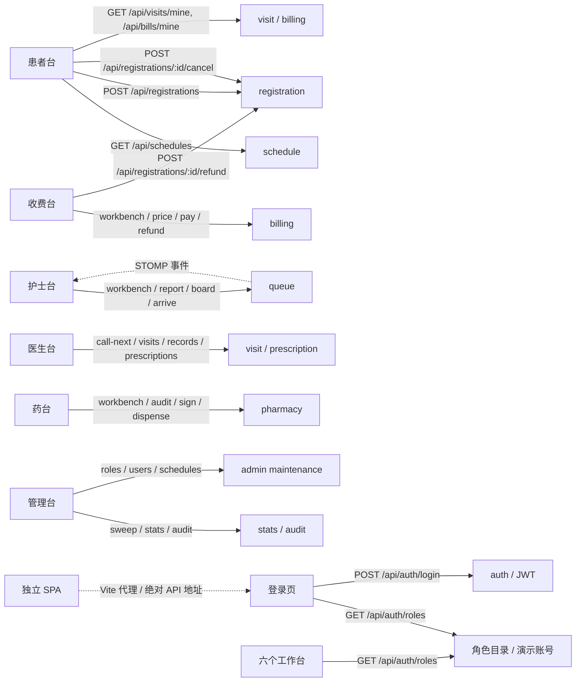

# 门诊挂号与就诊管理系统 · 概要设计说明书（体系结构与 SC 结构图）

| 项目 | 内容 |
| --- | --- |
| 文档编号 | HLD-OUTP-001 |
| 版本 | V1.7（基线收口、WebSocket 主题授权加固与审计完整性） |
| 上游文档 | 《01-产品需求文档PRD.md》V1.7 |
| 对应实验 | 实验三 概要设计（体系结构设计、模块划分、接口设计） |
| 状态 | 已按实现校准，待评审 |
| 变更记录 | V1.1 修正分层图、部署图、SC 图与 REST 端点为实际运行结构；新增前端 SPA、JWT Filter、WebSocket Broker、Queue Sweeper、Audit REQUIRES_NEW、MockInsuranceGateway；区分「已实现」「扩展设计」；V1.2 追加 GitHub 图示复核后的工作台 API 与浏览器证据回链；V1.3 把 SPA 从 Spring Boot `static` 移到独立 `frontend/`，补充 Vite 代理、CORS/WS 白名单和纯 API 后端边界；V1.4 按 PRD V1.4 补入患者取消与收费员退号的 REST、事务和界面职责；V1.5 补入管理员角色/账号/排班维护的 ADMIN 专属 API 与审计职责；V1.6 按业务连通性审计补入队列员工/患者双主题、患者脱敏、医生归属过滤与收费单详情归属校验；V1.7 将患者主题细化为按患者 ID 的专属脱敏主题，拒绝患者订阅员工完整主题，并补齐审计操作人/挂号审计和文档基线一致性 |

## 1. 设计目标与约束

设计要同时满足 PRD 的 NFR-14（低耦合高内聚）、NFR-15（外部系统以标准接口对接）、NFR-02（号源并发一致性）三条硬约束，并保证实验三类图中的 17 个业务类在代码里**一类一名可追溯**。

约束：单人课时内完成；数据库为关系型；不使用分布式中间件；医保系统不可用时业务可降级但不产生假成功。V1.1 明确区分两类内容：无标注者为当前代码已实现，`[扩展设计]` 标注者为后续演进目标，不得把演进目标写成已交付功能。

GitHub 核对结论：`campus-clinic-outpatient-billing` 的「登录先选身份、角色菜单与接口双重授权、异常单据单独成区、模块化单体」用于改善工作台信息组织；`Hospital-Appointment-Management-System` 的「JWT Filter + 角色工作台 + WebSocket 队列 + 看板降级」用于确认本系统前后端边界；`yujian95/hospital-web` 的「按角色区分医生管理员与系统管理员、按日期查看就诊队列」用于优化导航层级。详见《06-GitHub借鉴与选型说明.md》。

## 2. 体系结构

### 2.1 分层架构图



层间只允许**单向依赖**，禁止跨层调用（UI 不得直连 DAO，Controller 不得写 SQL）。`AuditService` 在业务事务内登记日志，外层 `AuditFlushAspect` 在业务事务释放连接后以 `REQUIRES_NEW` 独立事务写日志，不改变业务层到 Repository 的单向依赖。V1.3 起 SPA 独立部署，Spring Boot 不再托管业务 HTML/CSS/JS；所有 `/api/**` 业务接口仍经 `SecurityFilterChain` 鉴权，`/ws` 按白名单源完成握手。

注：Mermaid 节点文本里的 `/topic/queue/:doctorId/:workDate` 是为避免花括号被当作图形语法而使用的图示写法；员工订阅运行时主题 `/topic/queue/{doctorId}/{workDate}`，患者订阅 `/topic/queue/{doctorId}/{workDate}/masked/{patientId}`。V1.7 起旧的患者共享 `/masked` 主题已停用。V1.3 的静态资源不再由 `L1` 交付；开发态由 Vite 代理 `/api`、`/ws` 到 8080，生产态由 Nginx 或绝对 API 地址连接。详见《07-前后端分离架构与部署说明.md》。

图 SC-RUN-01 当前运行视图（V1.3 前后端分离）

```mermaid
flowchart LR
    B[浏览器<br/>HTML/CSS/原生 JS SPA] -->|HTTP 5173| FE[Vite Dev Server<br/>frontend/]
    FE -->|/api · /ws 代理| APP[Spring Boot 3.2.5<br/>Java 21 · 纯 API]
    APP -->|JDBC / JPA| DB[(MySQL 3306<br/>outpatient)]
    APP -->|SimpMessagingTemplate| BROKER[内存 STOMP Broker<br/>/topic]
    BROKER -->|队列事件| B
    APP -->|@Scheduled 20s| SW[QueueSweeper]
    SW --> APP
    APP -->|InsuranceGateway| MOCK[MockInsuranceGateway<br/>NORMAL/FAIL/TIMEOUT]
    MOCK -.未来替换.-> REAL[真实医保系统]
    ADM[管理员工作台] -->|GET /api/audit, /api/stats| APP
```

部署选择保持后端单体：号源、收费、发药都依赖本地事务；WebSocket Broker 只广播展示事件，队列状态与过号判定由服务端事务和定时器负责；医保 Mock 通过接口隔离，替换真实实现不需要改 `BillService`。前端是独立构建产物，但仍只依赖后端业务 API，不形成第二个业务真值源。

### 2.2 运行时部署图

```mermaid
flowchart LR
    B1[浏览器 / 自助机客户端] -->|HTTP 8080| APP[门诊系统单体应用<br/>Spring Boot]
    APP -->|JDBC| DB[(数据库服务 3306)]
    APP -->|标准接口 / 模拟实现| INS[医保系统]
    APP -->|@Scheduled 每 20s| JOB[QueueSweeper → QueueService.sweepMissed]
    JOB --> DB
```

选择单体部署的原因：需求边界内没有独立伸缩诉求，事务一致性（号源、发药、收费）依赖本地事务，拆微服务会把 BR-03 的并发正确性变成分布式问题，得不偿失。V1.1 的 `QueueSweeper` 是 Spring 容器内的调度组件，不是独立进程；`POST /api/queue/sweep` 保留给管理员手动触发演示。

## 3. 模块划分与 SC 结构图

### 3.1 顶层 SC 结构图（软件结构图）

SC 图按「控制层次 + 数据流」组织：上层为 SPA 主壳与横切组件，中层为 8 个业务功能模块，下层为子模块。箭头方向表示调用，标注 `C` 为控制耦合、`D` 为数据耦合。V1.1 保留课程要求的 8 个模块编号，并显式画出 JWT、WebSocket、调度、审计与医保网关。

```mermaid
flowchart TD
    ROOT[门诊 SPA 主壳<br/>frontend/index.html / src/main.js]
    ROOT -->|C| SEC0[登录与 JWT 会话]
    SEC0 -->|C| SEC1[SecurityFilterChain / JwtAuthenticationFilter]
    ROOT -->|C| AUDIT[AuditService<br/>REQUIRES_NEW]
    ROOT -->|C| WS0[WebSocket Broker<br/>/topic/queue/:doctorId/:workDate]
    ROOT -->|C| SWP[QueueSweeper<br/>@Scheduled 20s]
    ROOT -->|C| M1[M1 用户与权限]
    ROOT -->|D| M2[M2 排班与号源]
    ROOT -->|D| M3[M3 挂号管理]
    ROOT -->|D| M4[M4 分诊叫号]
    ROOT -->|D| M5[M5 就诊诊断]
    ROOT -->|D| M6[M6 划价收费]
    ROOT -->|D| M7[M7 药房管理]
    ROOT -->|D| M8[M8 查询统计]

    M1 --> M11[登录验证]
    M1 --> M12[角色权限校验]
    M1 --> M13[审计日志记录]
    M1 --> M14[用户与角色维护]

    M2 --> M21[排班维护]
    M2 --> M22[排班与余量查询]
    M2 --> M23[号源占用]
    M2 --> M24[号源释放]

    M3 --> M31[线上/自助机挂号]
    M3 --> M32[取消挂号]
    M3 --> M33[退号退费]
    M3 --> M34[我的挂号与就诊记录]

    M4 --> M41[分诊报到]
    M4 --> M42[队列顺序维护]
    M4 --> M43[叫号]
    M4 --> M44[到诊应答]
    M4 --> M45[过号判定与重排]

    M5 --> M51[接诊与患者信息核对]
    M5 --> M52[电子病历维护]
    M5 --> M53[处方开具]
    M5 --> M54[检查单开具]
    M5 --> M55[结束就诊]

    M6 --> M61[自动划价]
    M6 --> M62[收款登记]
    M6 --> M63[医保结算]
    M6 --> M64[退费办理]
    M6 --> M65[收费明细查询]

    M7 --> M71[处方审核]
    M7 --> M72[双人签字]
    M7 --> M73[配药发药]
    M7 --> M74[退药回补]
    M7 --> M75[库存查询与预警]

    M8 --> M81[就诊历史查询]
    M8 --> M82[医生工作量统计]
    M8 --> M83[门诊收入统计]

    M1 -.->|D| SEC1
    M4 -.->|C| SWP
    M4 -.->|D| WS0
    M6 -.->|D| MOCKGW[MockInsuranceGateway<br/>NORMAL / FAIL / TIMEOUT]
    MOCKGW -.NFR-15 可替换.-> EXT0[外部医保系统]
    M1 -.->|D| AUDIT
    M6 -.->|D| AUDIT
    M7 -.->|D| AUDIT
```

图 SC-MOD-01 当前代码包与模块映射（V1.1）



当前代码使用 `common/` 与 `config/`；《06》早期草案中的 `shared/` 是设计别名，V1.1 以实际包名为准，不为了对齐别名大规模移动代码。

### 3.2 结构度量

| 指标 | 数值 | 评价 |
| --- | --- | --- |
| 深度 | 3 层（SPA 主壳 → 8 个业务模块 → 子模块/横切组件） | 适中，避免深层嵌套调用 |
| 宽度 | 业务第 2 层 8 个模块；表示层 6 个工作台 | 模块与业务域、角色职责分别对应 |
| 扇入 | SEC1 鉴权、AUDIT 审计、REPO 数据访问扇入高 | 横切能力集中复用，符合低重复原则 |
| 扇出 | ROOT 扇出 8 个业务模块 + 4 个横切组件 | 由 SPA 路由集中调度，模块内部仍保持窄接口 |
| 耦合类型 | REST/JSON 数据耦合为主；路由与状态推进使用控制耦合 | 无公共耦合、无内容耦合 |

### 3.3 模块职责、输入输出与需求映射

| 模块 | 职责摘要 | 主要输入 | 主要输出 | 覆盖需求 | 持久摘要 |
| --- | --- | --- | --- | --- | --- |
| M1 用户与权限 | JWT 认证、`@PreAuthorize` 授权、独立事务审计 | 账号口令、Bearer Token、角色编码 | JWT、权限判定、日志行 | FR-31、FR-32、NFR-04~07 | sys_user、role、operation_log |
| M2 排班与号源 | 排班发布、余量维护、号源占放 | 医生/日期/时段、号源 ID | 排班列表、占用结果、余量 | FR-01~FR-04、BR-01~BR-03 | schedule |
| M3 挂号管理 | 挂号单生命周期 | 患者、号源、渠道 | 挂号单、号序、退号结果 | FR-05~FR-09、BR-02、BR-11 | registration、refund_record |
| M4 分诊叫号 | 报到、队列、叫号、过号、WebSocket 广播 | 挂号单 ID、医生 ID、出诊日期 | 候诊队列、叫号结果、重排结果、队列事件 | FR-10~FR-12、BR-04、BR-05、UI-04 | registration(call_order/queue_no/miss_count) |
| M5 就诊诊断 | 接诊、病历、处方、检查单 | 就诊 ID、病历内容、药品明细 | 就诊记录、处方、检查单 | FR-13~FR-18、BR-08 | visit、medical_record、prescription(+item)、checkup_order |
| M6 划价收费 | 计价、收款、医保、退费、查询 | 就诊 ID、支付方式、实收金额 | 收费单、结算流水、统计结果 | FR-19~FR-23、BR-09、BR-10、BR-12 | fee_bill、fee_item、insurance_settlement |
| M7 药房管理 | 审核、签字、发药、退药、库存 | 处方 ID、签字人、药品 | 发药流水、库存变化 | FR-24~FR-28、BR-06、BR-07 | prescription、dispense_record、medicine |
| M8 查询统计 | 历史、工作量与收入报表、审计检索 | 患者身份、时间段、动作 | 历史列表、统计卡片、审计日志 | FR-29、FR-30、FR-32、UI-05 | visit、fee_bill、operation_log、跨表视图 |

## 4. 接口设计

### 4.1 模块间内部接口（服务契约）

| 实验三类图/设计契约 | 当前实现类与方法 | 状态 |
| --- | --- | --- |
| `occupySlot(scheduleId)` / `releaseSlot(scheduleId)` | `RegistrationService.book(...)` 内锁 `Schedule` 行并更新 `remaining_qty`；`cancel/refund.releaseQuota` 在独立事务中回补余量 | 已实现挂号占用、取消与收费员退号；AC-23 验收 PASS |
| `refundRegistration(regId, operator)` | `POST /api/registrations/{regId}/refund` → `RegistrationService.refund(...)`；`POST /api/bills/refund` → `BillService.refund(...)` | 已实现并验收；整单退费后的诊疗状态级联口径仍为待确认边界 |
| `callNext(doctorId)` / `requeueMissed(regId)` | `QueueService.callNext(doctorId, workDate, doctor)` / `QueueService.sweepMissed()` | 已实现 |
| `startVisit(regId)` / 病历维护 | `VisitService.start / saveRecord / complete` | 已实现 |
| `buildBill(visitId)` / `pay(...)` | `BillService.price / pay / refund` | 已实现 |
| `settle(request)` | `InsuranceGateway.settle` → `MockInsuranceGateway` | 已实现 Mock |
| `audit / dispense / secondSign` | `PharmacyService.audit / secondSign / dispense / returnMedicine` | 已实现 |
| `writeLog(...)` | `AuditService.write` 登记 + `AuditFlushAspect` 事务外刷出，审计事务传播 `REQUIRES_NEW` | 已实现 |

下表保留实验三类图的语义签名，作为模块间调用契约；HTTP 端点以 4.2 节实际清单为准。

| 接口 | 提供方 | 调用方 | 入参 | 出参 | 异常 |
| --- | --- | --- | --- | --- | --- |
| `occupySlot(scheduleId)` | M2 | M3 | 号源 ID | 号序、挂号费 | 挂满即停、已停诊、过期 |
| `releaseSlot(scheduleId)` | M2 | M3、M7 | 号源 ID | 新余量 | 余量越界 |
| `refundRegistration(regId, operator)` | M3 | 收费工作台 | 挂号单 ID | 退费金额 | BR-11 拒绝 |
| `callNext(doctorId)` | M4 | 医生工作台 | 医生 ID | 被叫挂号单与号序 | 队列为空 |
| `requeueMissed(regId)` | M4 | 定时任务、护士 | 挂号单 ID | 新叫号位次 | 已应答不重排 |
| `startVisit(regId)` | M5 | M4 | 挂号单 ID | 就诊 ID | 状态非叫号中/未到诊 |
| `buildBill(visitId)` | M6 | 收费工作台 | 就诊 ID | 收费单 + 明细 | 无待收费单据 |
| `pay(billId, payType, paidAmount)` | M6 | 收费工作台 | 收费单 ID、支付方式、实收 | 支付结果 | BR-12 拒绝 |
| `settle(request)` | M9 医保网关 | M6 | 医保号、应收金额 | 统筹、自付、流水号 | 不可用/超时 |
| `audit(id, pharmacist)` | M7 | 药房工作台 | 处方 ID | 新状态 | 处方非已收费 |
| `dispense(id, signer1, signer2)` | M7 | 药房工作台 | 处方 ID、签字人 | 发药流水 | BR-06、BR-07、库存不足 |
| `writeLog(action, target, detail)` | M1 | 全部业务模块 | 动作、对象、明细 | 日志 ID | 不阻断主流程 |

### 4.2 对外 REST 接口分组

| 分组 | 实际端点 | 允许角色 | 说明 |
| --- | --- | --- | --- |
| 认证 | `POST /api/auth/login` | 公开 | 返回 `token/userId/username/realName/role/refId/permissions` |
| 管理员维护 | `GET/POST /api/admin/roles`、`PUT /api/admin/roles/{code}`、`GET/POST/PUT /api/admin/users`、`POST /api/admin/schedules`、`PUT /api/admin/schedules/{id}`、`POST /api/admin/schedules/{id}/close` | ADMIN | 角色目录、登录账号 PBKDF2 口令、启用状态、排班号源维护，所有写操作审计 |
| 排班号源 | `GET /api/schedules?workDate&deptId&doctorId` | 全部登录角色 | 返回排班、医生、科室、余量、挂号费 |
| 挂号 | `POST /api/registrations`、`GET /api/registrations/mine?patientId`、`POST /api/registrations/{id}/cancel` | PATIENT | 患者只能操作自己的 `refId`；取消前复核状态与归属 |
| 退号 | `POST /api/registrations/{id}/refund` | CASHIER | 收费员在终态前办理退号，事务内生成挂号费退费记录、回补号源并写审计 |
| 工作台只读 | `GET /api/registrations/workbench?status`、`GET /api/visits/workbench?status` | NURSE、DOCTOR、CASHIER、PHARMACIST、ADMIN | V1.1 为六个工作台补齐待办列表，按角色过滤 |
| 分诊叫号 | `POST /api/queue/report`、`POST /api/queue/call-next`、`POST /api/queue/arrive`、`GET /api/queue/board?doctorId&workDate`、`POST /api/queue/sweep` | NURSE、DOCTOR、PATIENT、ADMIN | 报到仅护士；叫号、看板和到诊确认仅本人医生；患者仅可查看本人当日挂号对应队列且其他候诊者脱敏；手动扫描仅管理员 |
| 就诊诊断 | `POST /api/visits/start`、`GET /api/visits/{visitId}`、`POST /api/visits/records`、`POST /api/visits/{visitId}/complete`、`GET /api/visits/mine` | DOCTOR、PATIENT、ADMIN | 病历保存与结束就诊仅本人接诊医生 |
| 处方/检查 | `POST /api/prescriptions`、`POST /api/prescriptions/checkups`、`GET /api/prescriptions/visit/{visitId}`、`GET /api/prescriptions/workbench?status`、`GET /api/prescriptions/checkup-catalog` | DOCTOR、PHARMACIST、CASHIER、PATIENT、ADMIN | 按角色做数据范围校验；检查项目字典供医生开单 |
| 划价收费 | `POST /api/bills/price`、`POST /api/bills/pay`、`POST /api/bills/refund`、`GET /api/bills/workbench?status`、`GET /api/bills/{billId}`、`GET /api/bills/mine` | CASHIER、PATIENT、ADMIN | 收费台可列出 `UNPAID/PAID/RETRY/REFUNDED`；患者详情和列表均只允许本人 `refId` |
| 药房 | `POST /api/pharmacy/audit`、`POST /api/pharmacy/second-sign`、`POST /api/pharmacy/{id}/dispense`、`POST /api/pharmacy/{id}/return`、`GET /api/pharmacy/medicines` | PHARMACIST | 发药前校验审核与精神类双签 |
| 统计 | `GET /api/stats/workload?start&end`、`GET /api/stats/revenue?start&end` | ADMIN、DOCTOR、CASHIER | 管理员看全院医生工作量；医生只返回本人 `refId`；收入按已收费金额聚合 |
| 审计 | `GET /api/audit?action&start&end` | ADMIN | 操作日志只插入、只查询 |
| 实时队列 | `WS /ws?token=<JWT>`，员工订阅 `/topic/queue/{doctorId}/{workDate}`，患者订阅 `/topic/queue/{doctorId}/{workDate}/masked/{patientId}` | NURSE、DOCTOR、PATIENT、ADMIN | 握手用 query token 完成 JWT 鉴权；患者只能订阅本人且当日有有效挂号的主题，广播仅保留本人身份；断线回退 `GET /api/queue/board` |

统一响应结构：`{code, message, data}`，`code=0` 成功；401 未登录、403 角色不足、400 参数/业务规则拒绝、409 状态冲突、502 医保不可用。除登录异常外，这些错误经常以 HTTP 200 + 非零 `code` 返回，前端必须先判断 `code`。V1.3 以前的历史文档曾把 Spring Boot `static` 资源列为公开路径，该段仅为迁移前记录；当前业务 `/api/**` 全部鉴权，静态资源由独立前端交付。

V1.3 修正：Spring Boot 不再公开上述静态资源，`/` 返回 JSON 服务标识；公开的后端端点仅 `/api/auth/login`、`/api/auth/roles`、`/ws` 和 `/error`。静态资源由 `frontend/` 的 Vite/Nginx 交付，详见《07》。

图 SC-API-01 六个工作台的主要 API 调用（V1.5）



V1.2 借鉴 GitHub 同类项目的角色工作台组织后，补充 `GET /api/auth/roles` 作为登录身份目录，并在患者/护士/医生/收费/药房/管理员工作台统一执行 `code=0` 判定、Bearer JWT、401 回登录和中文错误展示。SC-API-01 边标签里的 `:id` 是 Mermaid 图示写法；运行时真实 URI 为 `POST /api/registrations/{regId}/cancel` 与 `POST /api/registrations/{regId}/refund`，其中 `{regId}` 替换为挂号单 ID。界面截图、医保 FAIL 交互证据与 DOM 断言见 `docs/images/`；SC-API-01 描述当前实际调用链，`price_item`、批次库存、幂等键等仍按 05/06 文档标为扩展设计，不因界面复核改写为已交付。

### 4.3 外部接口：医保结算契约（NFR-15）

```
接口名：InsuranceGateway（当前 Java 契约）
方法：InsuranceResult settle(String insuranceNo, BigDecimal totalAmount, Long billId)
  入参 insuranceNo   医保号，必填
       totalAmount   应收金额，>0
       billId        本地收费单号，用于对账
  出参 success       是否结算成功
       fundAmount    统筹支付
       selfAmount    个人自付
       tradeNo       外部流水号（回传，落库存档）
       errorCode     失败原因编码
       errorMessage  中文失败原因
```

实现策略：交付 `MockInsuranceGateway`（按配置 `app.insurance.mode = NORMAL | FAIL | TIMEOUT` 行为切换，用于验收演示 BR-10 失败分支）；当前接口没有 `available()` 方法，前端根据收费单 `RETRY` 状态和结算流水显示通道异常，不自行猜测网关健康状态。接真实医保时新增实现类替换 Bean，业务层零改动。这是 NFR-15 的落地点，也是实验一「接口可扩展」的实证。

## 5. 关键设计决策

| 编号 | 决策 | 备选方案 | 取舍理由 |
| --- | --- | --- | --- |
| AD-01 | 号源占用采用「行锁 + 条件更新」两段式 | 悲观表锁 / 分布式锁 | 行锁粒度到单个号源，既满足 BR-03 又保住吞吐 |
| AD-02 | 号序 `queue_no` 与叫号顺序 `call_order` 分离 | 复用单一字段 | 号序是患者取号凭证不可变；叫号顺序要支持过号重排与护士调整，二者生命周期不同 |
| AD-03 | 过号判定用定时扫描 + 叫号时间戳 | 前端倒计时 | 前端不可信，服务端判定才能满足 BR-04 的一致性 |
| AD-04 | 处方状态机集中校验，非法跃迁直接拒绝 | 各操作自行判断 | BR-06/BR-07 涉及用药安全，必须单点收口 |
| AD-05 | 发药扣库存使用 `WHERE stock >= qty` 条件更新 | 先查后改 | 避免查改竞态，配合事务保证 BR-07 与 AC-13 |
| AD-06 | 敏感字段 AES-GCM 加密入库 + 展示脱敏 | 明文存储加界面掩码 | NFR-06 要求存储加密，直接查库不得出现明文 |
| AD-07 | 医保失败写 FAILED 流水并将收费单置为 RETRY | 静默转自费 | BR-10 明确禁止假成功，且需支持原单重试 |
| AD-08 | 单体 + 本地事务，不引入消息队列 | 事件驱动 | 实验规模下复杂度收益不匹配 |
| AD-09 | 原生静态 SPA + JWT + REST，不引入 Vue/Element UI 构建链 | Vue 3 / React 独立前端工程 | 课程验收要求开箱即用；静态资源随 Spring Boot 打包，避免额外 Node 部署；GitHub 项目仅借鉴其角色导航与看板信息架构 |
| AD-10 | WebSocket 握手用 query token 鉴权，业务状态仍以 REST 与服务端定时器为准 | 无鉴权 STOMP / 仅前端倒计时 | 保持 NFR-04/05 与 BR-04 的服务端一致性；断线可轮询降级 |

## 6. 依赖矩阵与耦合检查

行调用列，`●` 直接依赖，`○` 仅通过接口依赖。

| 调用方 ↓ / 被调 → | M1 | M2 | M3 | M4 | M5 | M6 | M7 | M8 | M9 |
| --- | --- | --- | --- | --- | --- | --- | --- | --- | --- |
| M1 | | | | | | | | | |
| M2 | ● | | | | | | | | |
| M3 | ● | ● | | | | ○ | | | |
| M4 | ● | | ● | | ○ | | | | |
| M5 | ● | | ● | ● | | | | | |
| M6 | ● | | ● | | ● | | ○ | | ○ |
| M7 | ● | ○ | | | ● | ● | | | |
| M8 | ● | | ● | | ● | ● | ● | | |
| M9 | | | | | | | | | |

检查结论：M9 医保网关不回调任何业务模块；业务事务只登记审计事件，外层切面在事务完成后以 `REQUIRES_NEW` 独立落库，既不阻断业务，也不在持号源行锁时抢占第二条连接；业务异常不写成功审计。M7 的取消/退号经 `RegistrationService.releaseQuota` 回写 `schedule`，M3 已实现挂号占用与释放；V1.7 起不再把取消/退号标记为扩展设计。

## 7. 数据库设计概述

20 张表 + 3 个业务视图；V1.7 不新增表结构，只调整审计写入口径，按主题域分为系统与权限、组织与人员、号源与挂号、就诊与诊疗单据、费用与医保、药房与库存六组。表结构、约束与视图的完整定义见《04-数据库设计说明书.md》，ER 图在该文档第 3 节。

## 8. 出错处理设计

| 错误类别 | 处理策略 | 用户可见表现 |
| --- | --- | --- |
| 业务规则拒绝 | 抛出 BizException，事务回滚，不写成功日志 | 中文提示 + 异常流编号 |
| 医保通道异常 | 写 FAILED 流水，收费单置 RETRY，允许重试 | 「医保系统暂不可用，已保留待重试」 |
| 数据访问异常 | 记录堆栈并返回 500 统一响应 | 「系统繁忙」 |
| 并发冲突 | 条件更新返回 0 行即判定失败 | 「号源已被占完，请重新选择」 |
| 参数校验失败 | 在进入业务前拦截 | 字段级提示 |

## 9. 与实验三类图的一致性检查

| 类图对象 | 承载模块 | 实现类 | 备注 |
| --- | --- | --- | --- |
| 用户 / 角色 / 系统管理员 | M1 | sys_user、role、AuthService / AuthUserDetailsService | 角色权限以编码串保存；认证改为 JWT |
| 患者 / 医生 / 科室 | M1、M5 | patient、doctor、department | 电话字段加密 |
| 号源 | M2 | schedule + ScheduleService | 占用/释放两个动作对应类图方法 |
| 挂号单 | M3 | registration + RegistrationService | 状态字段实现类图「状态」属性 |
| 就诊 / 就诊记录 / 电子病历 | M5 | visit、medical_record | 一次就诊一份病历 |
| 处方 | M5、M7 | prescription、prescription_item | 一对多落实 BR-08 |
| 药房人员 | M7 | 由 PHARMACIST 角色承载 | 审核人、双签字人字段留痕 |
| 药品 | M7 | medicine + dispense_record | 当前用单列库存 + 发药/退药流水；批次库存属扩展设计 |
| 收费单 | M6 | fee_bill、fee_item | 「生成收费单/结算/退费」三方法 |
| 医保结算 | M6、M9 | insurance_settlement + InsuranceGateway | 实现类图「医保系统接口」 |
| 检查单 | M5 | checkup_order + checkup_catalog | 补齐 FR-16 |

## 10. 待确认事项

- Q-01 挂号费是否在收费台并入收费单（V1.1 决议：是，`BillService.price` 按 `REGISTRATION` 来源并入，未付时才计入）。
- Q-02 已完成就诊是否允许修改病历（V1.1 决议：禁止，`VisitService.saveRecord` 对 `COMPLETED` 返回 409）。
- Q-03 医保是否需要按比例之外的「起付线/封顶线」计算（V1.1 决议：本期 Mock 只按 `fund-ratio` 拆分，扩展点保留在网关）。
- Q-04 退药是否允许部分退（V1.1 决议：整方退药，`PharmacyService.returnMedicine` 回补处方全部明细）。
- Q-05 患者取消挂号、收费员退号退费是否需要本期 REST 端点（V1.1 决议曾列为后续补齐项；V1.4 按 PRD AC-23 补齐两个端点和工作台按钮，保留「已收费挂号费复合退费」为后续增强项）。
- Q-06 用户/角色维护与排班维护是否必须由管理员在系统内完成（V1.5 决议：按 A-01 与 UC-20 补齐 ADMIN 专属 REST 与独立 SPA 表单，不引入智能排班、患者档案 CRUD 或账号删除；口令只写哈希，维护记录写审计）。

前四条已在当前代码中形成明确口径；Q-05 的取消/退号端点已在 V1.4 形成设计并验收；Q-06 的管理维护端点已在 V1.5 形成设计并由 `admin-maintenance-report.json` 记录 AC-24 PASS，不把扩展的复合退费流程写成已交付。

## 11. 借鉴开源项目后的架构增强

本节汇总《06-GitHub借鉴与选型说明.md》中对概要设计的影响。参考仓库不改变系统边界，只强化安全、并发、审计与实时性。

| 增强点 | 引入内容 | 对应模块 | 影响 |
| --- | --- | --- | --- |
| SE-01 认证授权 | Spring Security + JWT + `@PreAuthorize` | M1 | 已实现；接口级权限由框架统一管理，前端按 `code` 处理 401/403 |
| SE-02 敏感数据 | AES-GCM 加解密与脱敏；HMAC 盲索引 `[扩展设计]` | M1、M5 | 已实现密文入库与手机号掩码；盲索引表尚未落地 |
| SE-03 金额 | `BigDecimal` + `DECIMAL(12,2)`；`Money` 值对象 `[扩展设计]` | M6、M7 | 当前无浮点金额运算，前端统一两位小数 |
| SE-04 价格 | 单据快照；`price_item` 版本表 `[扩展设计]` | M6 | 已实现处方/检查单价格快照，调价不影响已有单据 |
| SE-05 号源 | 行锁 + 有效挂号生成列唯一索引 | M2、M3 | 已实现同患者重复占用防护；条件更新为后续健壮性增强 |
| SE-06 叫号 | WebSocket 员工主题 `/topic/queue/{doctorId}/{workDate}`、患者专属主题 `/topic/queue/{doctorId}/{workDate}/masked/{patientId}` + `QueueSweeper` | M4 | 已实现主题授权、按患者订阅级脱敏与定时扫描；前端断线时轮询 `GET /api/queue/board` |
| SE-07 审计 | 单表只插入/查询 + 业务事务登记 + 外层切面 `REQUIRES_NEW` | M1 | 已实现独立事务且并发不占双连接；独立日志库为生产扩展 |
| SE-08 库存 | 单列库存 + 发药/退药流水；批次/锁定 `[扩展设计]` | M7 | 已实现发药锁定药品行并整体事务回滚 |
| SE-09 幂等 | 挂号与收费状态前置校验；`Idempotency-Key` `[扩展设计]` | M2、M6 | 当前避免重复点击产生多条单据的主要手段是状态机与唯一约束 |
| SE-10 角色界面 | 登录身份、角色工作台、异常状态单独成区、队列实时看板 | 表示层 | V1.1 借鉴 GitHub 同类项目的信息组织，不复制源码或引入范围外模块 |

已实现项在 SD 与 RTM 中有对应时序/证据；`[扩展设计]` 项不得在验收时表述为已交付。

V1.5.3 图集交付口径：本文 6 张 Mermaid 图由 `scripts/export-mermaid-diagrams.mjs` 按图源原样导出到 `docs/images/diagrams/`，不重绘语义、不新增模块或端点；导出清单与 AC-25 结果见 `docs/09-图集导出与演示记录.md`。

V1.5.4 性能口径：AC-26 只压测已存在的 `POST /api/registrations` 链路，不引入新模块或缓存；V1.7 的审计先登记、后由外层切面在业务事务释放连接后独立落库，同一请求不同时占用两条业务连接。本机 Hikari 最大连接数保持 20、连接等待 5 秒；`docs/10-50并发性能压测说明.md` 记录本机 50 并发、连接池与 P95 边界。
