# 门诊挂号与就诊管理系统 · 详细设计说明书（SD 时序图与状态图）

| 项目 | 内容 |
| --- | --- |
| 文档编号 | DLD-OUTP-001 |
| 版本 | V1.7（WebSocket 患者专属主题、审计操作人与基线一致性收口） |
| 上游文档 | 《01-产品需求文档PRD.md》V1.7、《02-概要设计说明书-SC结构图.md》V1.7 |
| 对应实验 | 实验四 活动图 / 实验五 时序图 / 详细设计（核心流程与界面） |
| 说明 | 本文中 SD 指时序图（Sequence Diagram）；状态机另立章节，覆盖挂号单、处方、收费单、就诊四个对象 |
| 变更记录 | V1.1 将设计概念类名补齐 SPA/JWT、看板实时与轮询降级、医保失败重试、审计独立事务、手动/定时过号扫描时序；标注当前实现与扩展设计；V1.2 按 GitHub 角色工作台借鉴结果补充身份目录与浏览器验收校核点；V1.3 补充独立前端进程、Vite 代理、CORS 预检与绝对 API/WS 地址配置；V1.4 重绘 SD-07 并新增取消挂号流程、号源释放校验和前端路径校准；V1.5 新增 SD-15 管理员维护时序、号源容量规则与 AL-14/15 校验点；V1.6 更新队列双主题、患者脱敏、收费单/医生归属校验与 AL-16；V1.7 细化患者专属脱敏主题、订阅授权、关键审计操作人与 REQUIRES_NEW 语义，并新增 AL-17/18 |

## 1. 阅读约定

- 实线箭头 `->>` 表示同步调用，虚线 `-->>` 表示返回。
- `alt / else` 块表示分支，`loop` 表示迭代，`Note over` 标注业务规则编号（BR-xx）。
- 每张图下方列出「异常流落点」，与 PRD 的 `E-xx` 一一对应，测试阶段直接按这张表设计用例。
- V1.1 的「当前实现」使用实际类/端点：`QueueService`、`VisitService`、`PrescriptionService`、`BillService`、`PharmacyService`、`AuditService`、`MockInsuranceGateway`。早期草案中的 `TriageQueueService`、`DispenseService`、`OperationLogService`、`MissedQueueSweeper` 是设计别名，不作为交付类名。
- `[扩展设计]` 表示 GitHub 借鉴后的演进目标（价格版本表、批次库存锁、幂等键、refresh token 黑名单等），当前代码未实现，验收时不得当作既有功能。
- 前端统一读取 `{code,message,data}` 的 `code`；`code=0` 才显示成功，`code=401` 清理本地 JWT 并回登录页。

## 2. SD-01 在线挂号（含号源并发占用）

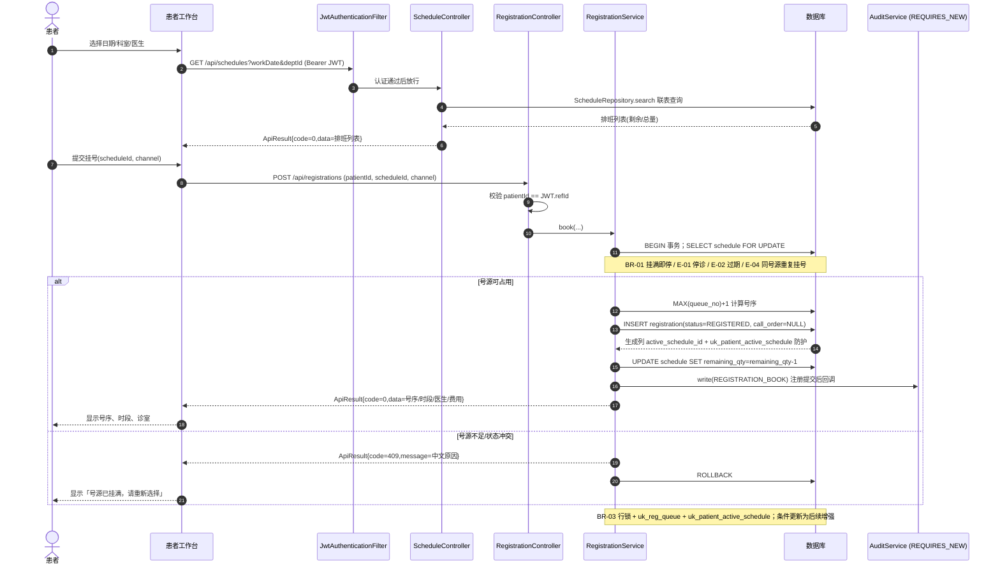

异常流落点：E-01 停诊拒绝、E-02 过期拒绝（锁行校验阶段）；E-04 重复挂号由服务查重与生成列唯一索引双重拦截；BR-01/BR-03 由号源行锁、同事务锁定当前号源挂号单读取 `MAX(queue_no)`、号序唯一约束和有效挂号唯一索引共同保障。V1.5.2 并发验收发现：仅锁号源行、以普通 `MAX` 子查询取号序时，MySQL 快照读会让并发事务拿到同一号序，并由 `uk_reg_queue` 以完整性异常拒绝；修复后 `RegistrationService.book` 不再调用该方法，而用同一事务内的 `findByScheduleForUpdate(schedule)` 锁定已有挂号记录再计算下一号序。当前 `RegistrationService` 直接完成占位，不单独暴露 `ScheduleService.occupySlot`。

## 3. SD-02 分诊报到与叫号

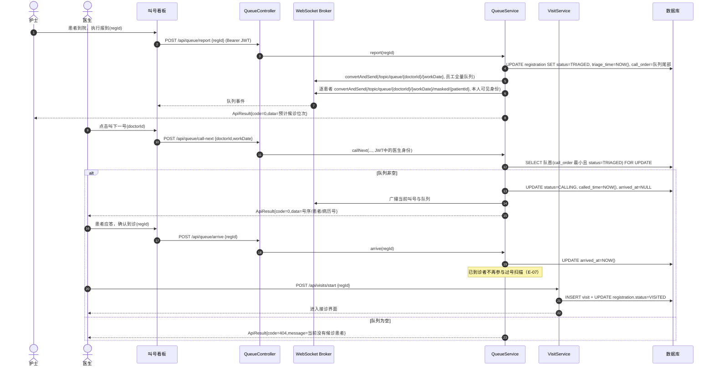

异常流落点：E-05 未报到不能叫号（队首只筛选 `TRIAGED`）；已有 `CALLING` 未应答时拒绝再叫号；开始就诊要求 `status=CALLING 且 arrived_at IS NOT NULL`。叫号医生必须是 JWT `refId` 对应医生，WebSocket 只推送展示事件，不改变业务状态。

## 4. SD-03 过号判定与重排（3 分钟 / 当前号后第 3 位）

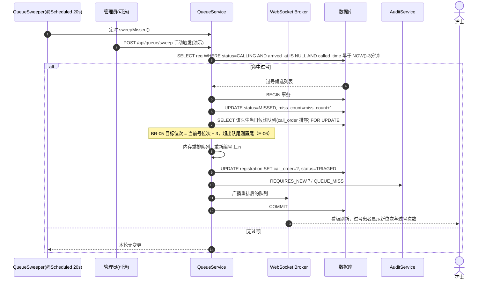

V1.1 实现说明：当前 `QueueService.sweepMissed()` 将超时 `CALLING` 记录先按原队列下标定位，再插入 `baseIndex + insertBehind + 1` 位置，最后在同一事务内重排 `call_order` 并回到 `TRIAGED`；`miss_count` 累加，状态机不写入终态 `MISSED`。`QueueSweeper` 每 20 秒调用一次，`POST /api/queue/sweep` 仅管理员可手动触发。若 WebSocket 不可用，前端按 UI-04 轮询 `GET /api/queue/board` 获取同一服务端状态。

重排算法（服务端唯一实现点，护士手工调整队列复用同一函数）：

```text
输入：doctorId, workDate, missedRegId, insertBehind=3
1  Q = 取该医生当日全部候诊挂号单（status IN (REGISTERED,TRIAGED,CALLING)），
   按 call_order 升序，call_order 为空者按 reg_time 追加到队尾
2  base = 当前号在 Q 中的下标；当前号取「最近一次被叫且已应答」的记录，
   若不存在则 base = 被移除元素自身的原下标
3  从 Q 中移除 missedReg
4  target = min(base + insertBehind + 1, Q.size)     // 插入到当前号后第 3 位
5  在 target 处插入 missedReg
6  对 Q 逐条回写 call_order = 下标 + 1（同一事务内完成，禁止部分写回）
```

复杂度 O(n)，n 为该医生当日候诊人数（业务上限约 30），无需分页。

## 5. SD-04 医生接诊：病历 + 多张处方 + 多张检查单

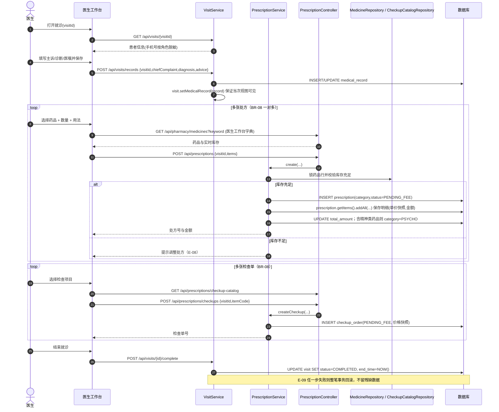

要点：处方类别由明细中是否含精神类药品自动推导为 `PSYCHO`，驱动后续 BR-07 双人签字；单价一律快照，历史处方不受调价影响。当前病历维护只有新增/更新一份病历（同一 `visit_id` 唯一），DELETE/PUT 独立 CRUD 属于 `[扩展设计]`。

## 6. SD-05 划价收费与医保结算（含失败重试）

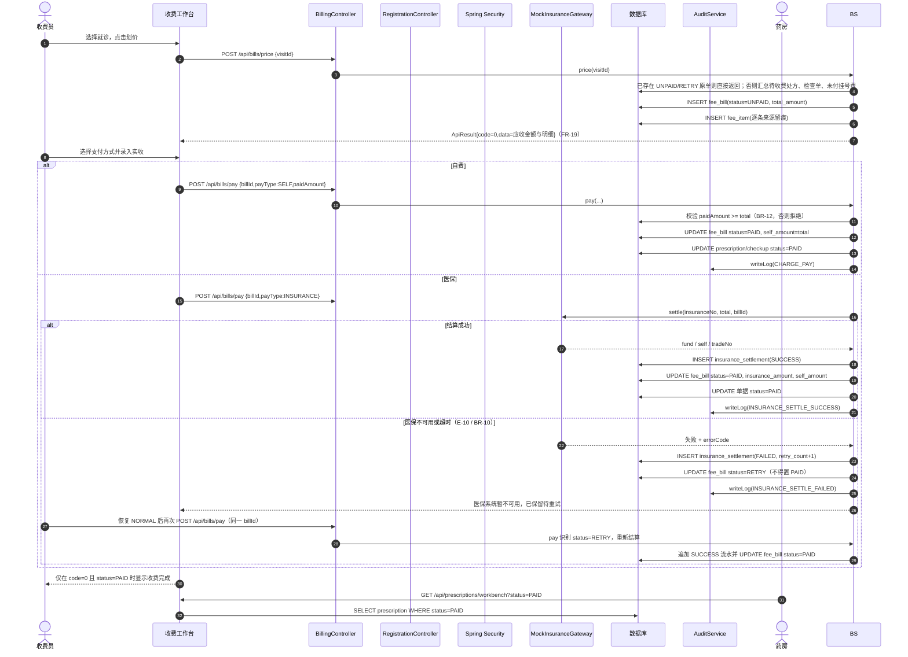

V1.1 补充：`RETRY` 单据不是失败终点，原 `billId` 可再次调用 `POST /api/bills/pay`；每次尝试新增一条 `insurance_settlement` 并累计 `retry_count`。前端不得把 `code=0` 但 `data.status=RETRY` 的医保失败响应误显示为「收费成功」，必须按 PRD UI-05 单独展示。

## 7. SD-06 处方审核、双人签字与发药退药

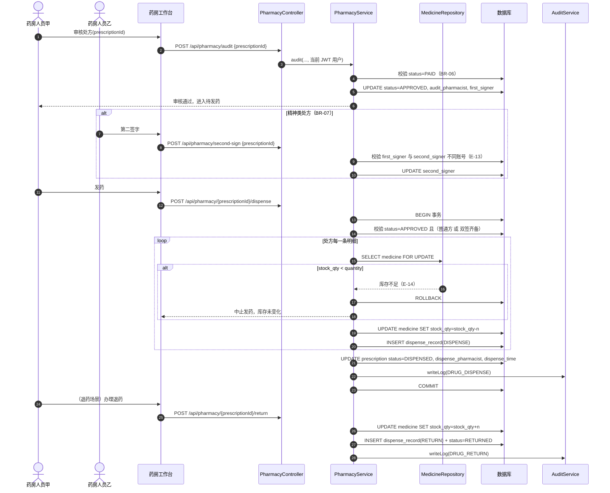

V1.1 实现说明：当前使用 `MedicineRepository.findWithLockById` 的悲观行锁 + `@Transactional` 整体回滚来保证 AC-13；SQL 层 `WHERE stock_qty >= n` 条件更新与批次库存锁定属于 `[扩展设计]`。

## 8. SD-07 退号退费

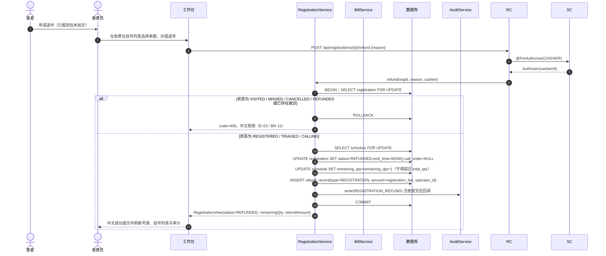

V1.4 实现口径：`RegistrationService` 在单事务内锁定挂号单与号源，退号只允许 `REGISTERED / TRIAGED / CALLING` 且尚无就诊记录，回补余量受 `schedule.total_qty` 边界约束，并写 `REGISTRATION` 类型退费记录与独立事务审计。`BillService.refund` 仍是收费单整单退费，不因挂号单退号自动作废其他医疗费；「挂号费已并入收费单后一次点击复合退费」保留为 `[扩展设计]`。患者取消走 `POST /api/registrations/{id}/cancel`，只允许本人 `REGISTERED` 且未报到单据，状态置 `CANCELLED`，同样回补号源但**不生成退费记录**。两个端点变更后通过 STOMP 队列广播刷新看板；前端按钮隐藏只改善体验，角色与归属必须由服务端复核。

#### 图 SD-07A 患者取消挂号

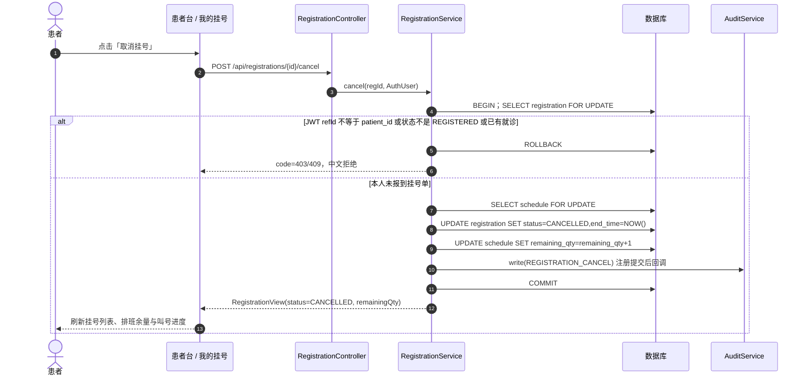

## 9. 状态图

### 9.1 挂号单状态机（FR-08 / BR-02 / BR-04 / BR-05 / BR-11）

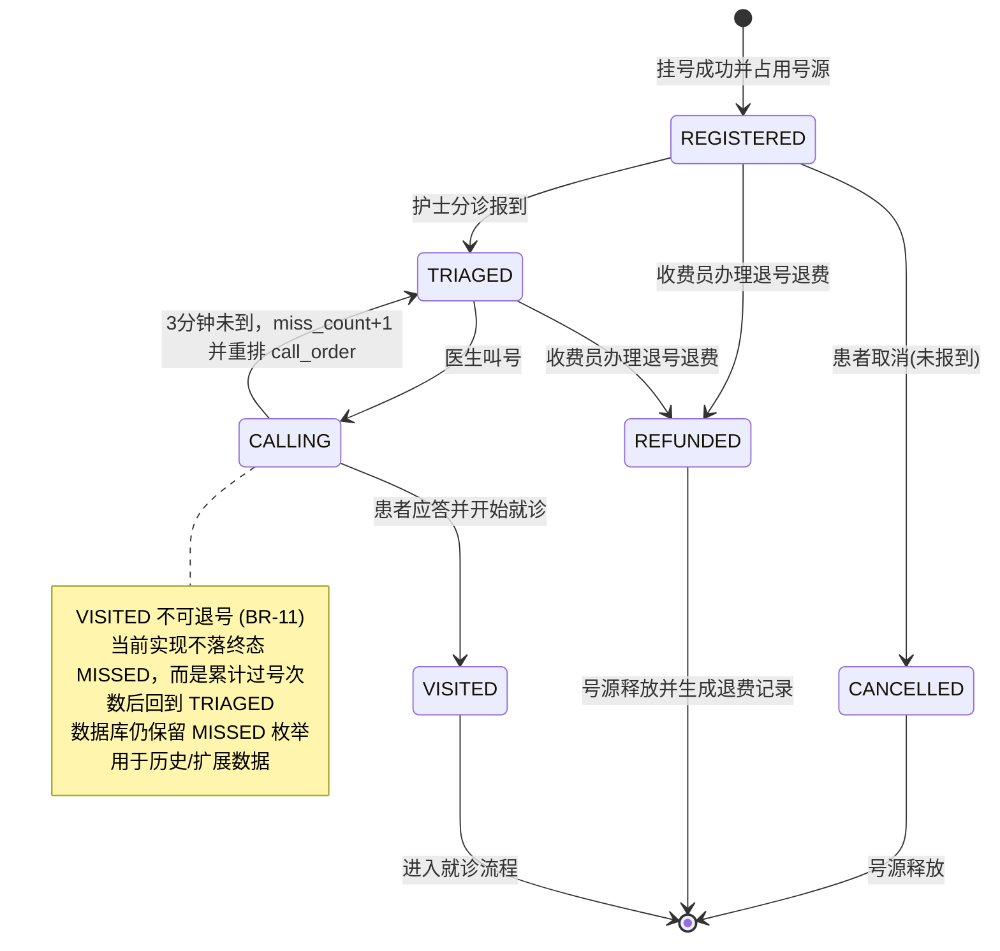

### 9.2 处方状态机（BR-06 / BR-07 / BR-08）

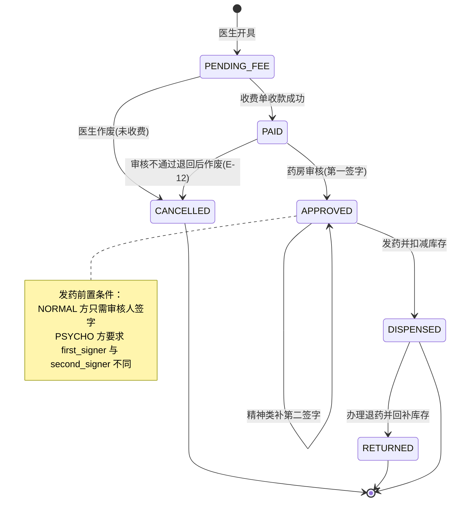

### 9.3 收费单状态机（BR-09 / BR-10 / BR-12）

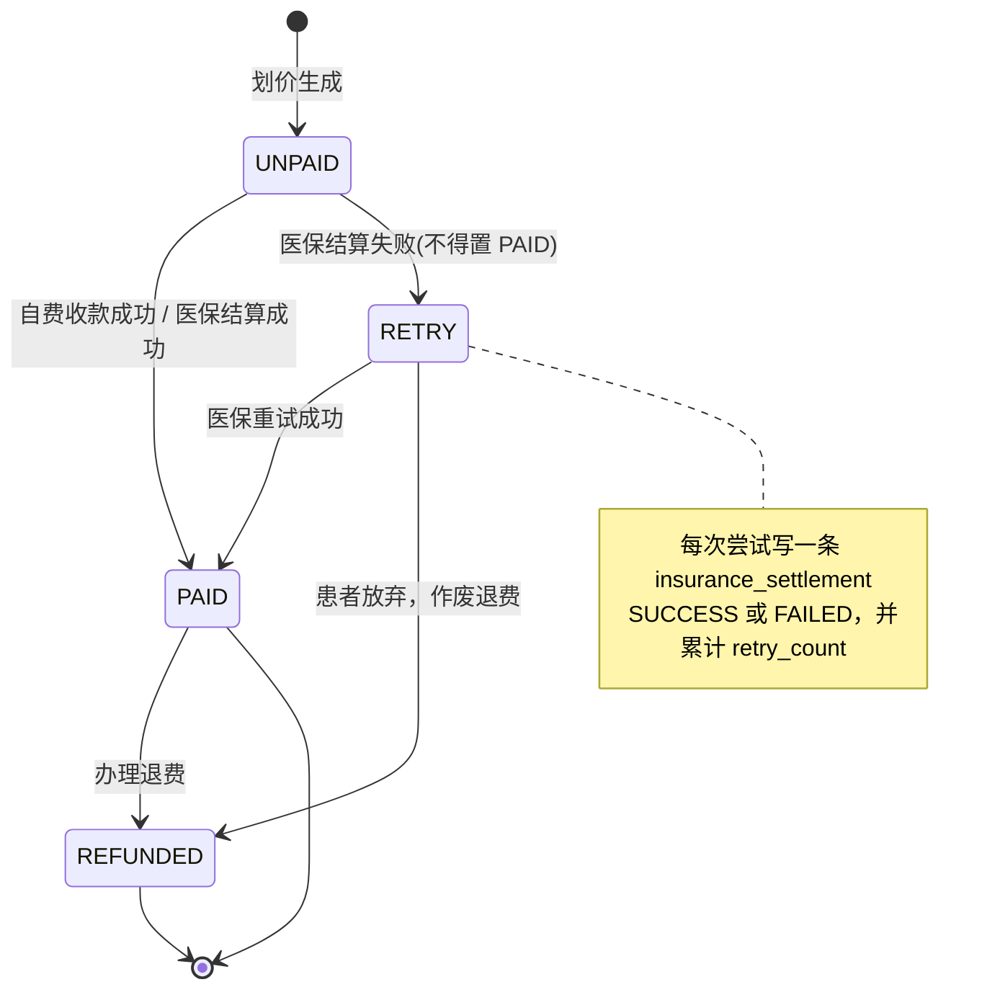

### 9.4 就诊状态机

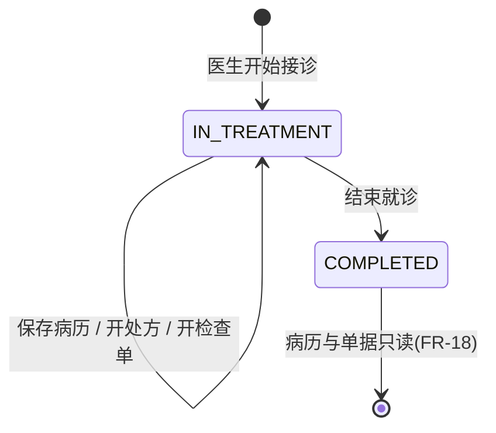

## 10. 核心算法与校验点清单

| 编号 | 算法/校验 | 位置 | 关联规则 | 单测点 |
| --- | --- | --- | --- | --- |
| AL-01 | 号源占用（行锁 + 号序生成 + 有效挂号唯一索引） | RegistrationService.book / RegistrationRepository | BR-01/BR-03 | 并发 20 抢 15 |
| AL-02 | 号源释放（挂号/号源双行锁、不越界回补、终态幂等拒绝） | RegistrationService.cancel/refund、ScheduleRepository | BR-02/BR-11 | 取消后重复取消、退号后重复退号、余量恰好等于总量 |
| AL-03 | 过号判定（时间戳比较） | QueueSweeper → QueueService.sweepMissed | BR-04 | 2 分 59 秒与 3 分 01 秒 |
| AL-04 | 队列重排（当前号后第 3 位） | QueueService.sweepMissed | BR-05 | 队尾不足、队首过号、二次过号 |
| AL-05 | 处方类别推导（含精神类即 PSYCHO） | PrescriptionService | BR-07 | 混合明细 |
| AL-06 | 划价合计（处方+检查+挂号费） | BillService | FR-19 | 空单据、重复划价 |
| AL-07 | 医保拆分（统筹/自付按比例取整） | MockInsuranceGateway | BR-09/BR-10 | 比例 0.7 的进位规则 |
| AL-08 | 发药扣库存（药品行锁 + 事务回滚） | PharmacyService / MedicineRepository | FR-26 | 库存恰好等于需求量 |
| AL-09 | 双人签字校验（不同账号） | PharmacyService.secondSign / dispense | BR-07 | 同一人签字两次 |
| AL-10 | 敏感字段加解密与脱敏 | PhoneCipher | NFR-06 | 密文可回解、掩码长度 |
| AL-11 | JWT 解析、角色授权与 401/403 统一响应 | JwtAuthenticationFilter / SecurityConfig | NFR-04/05 | 无 token、过期 token、跨角色调用 |
| AL-12 | 审计独立事务写入 | AuditService.write + AuditFlushAspect + REQUIRES_NEW | FR-32/NFR-07 | 业务事务内登记，事务资源释放后写日志，业务回滚不写成功审计，避免行锁期间双连接饥饿 |
| AL-13 | 前端响应判定与断线降级 | frontend/src/main.js（Bearer JWT / code / board 轮询） | UI-02/UI-04 | HTTP 200 + code=401/409/502 |
| AL-14 | 账号口令与引用完整性校验 | AdminMaintenanceService、PasswordHasher、SysUserRepository | FR-31/NFR-04/09 | 口令只写哈希、角色存在、患者/医生 refId 有效、不能禁用当前管理员 |
| AL-15 | 排班容量与唯一时段校验 | ScheduleMaintenanceService、ScheduleRepository | FR-01/BR-01/03 | 总量不小于已占用量、余量随总量差值同步、`uk_schedule_slot` 冲突、停诊仍保留挂号记录 |
| AL-17 | WebSocket 主题授权与订阅级脱敏 | WebSocketAuthInterceptor、QueueEventPublisher、QueueView、前端 startQueueLive | FR-10/11、NFR-04/05、AC-28 | 患者仅可订阅 `/topic/queue/{doctorId}/{workDate}/masked/{patientId}` 且 patientId 必须等于 JWT refId；服务端按订阅者保留本人身份并抹去其他患者身份；员工完整主题只开放 ADMIN/NURSE/本人医生 |
| AL-18 | 关键审计操作人完整性 | RegistrationService、QueueService、BillService、AuditService、AuditFlushAspect | FR-02/05/10/11、NFR-07、AC-29 | 登录用户动作透传 AuthUser；定时任务使用 SYSTEM 身份；外层切面在业务事务释放连接后以 REQUIRES_NEW 写日志，不等同业务与日志同事务原子一致 |
| AL-16 | 业务读写的对象归属校验 | BillService、QueueService、StatsService、RegistrationRepository | FR-09/10/11/30、NFR-04/05 | 患者只能读本人收费单/队列；患者队列其他候诊者身份置空；医生只能查看/确认本人队列并只统计本人工作量；WebSocket 员工与患者双主题分流 |

## 11. 界面设计（与状态机对齐）

| 界面 | 主控件 | 状态可见性 | 拒绝提示 |
| --- | --- | --- | --- |
| 患者工作台 | 排班筛选 + 挂号按钮 + 我的挂号（含本人取消）/就诊/账单 Tab | 剩余号源、号序、中文状态标签、取消后号源余量 | 号源已挂满 / 已停诊 / 重复挂号 / 已报到不可取消 |
| 护士叫号看板 | 医生/日期选择 + 当前叫号大字 + 队列卡片 + STOMP 状态 | call_order 排序、过号次数标黄、到诊标记 | 队列为空 / 重复报到 |
| 医生工作台 | 候诊队列 + 接诊 + 病历表单 + 药品/检查项目选择 | 仅 CALLING 且已应答可进入接诊；完成后只读提示 | 患者未到诊 / 已完成就诊再开单 |
| 收费工作台 | 待办就诊 + 划价明细 + 支付方式 + 收费单列表 + 可退号挂号列表 | UNPAID/PAID/RETRY/REFUNDED 分区；RETRY 显示重试次数；挂号终态中文标签 | 实收小于应收 / 医保不可用 / 已就诊或终态不可退号 |
| 药房工作台 | 待审核/待发药列表 + 双签状态 + 发药/退药 + 库存预警 | 精神类处方强制显示第一/第二签字人 | 未审核 / 缺第二签字 / 库存不足 |
| 管理后台 | 工作量/收入卡片 + 过号扫描 + 审计日志表 | 统计区间、日志动作过滤、扫描结果 | 权限不足 / 查询区间不合法 |

六个工作台共用一套响应处理：所有请求带 Bearer JWT，只有 `code=0` 才更新本地数据；401 回登录，403/404/409/502 显示 `message`；金额和日期按 UI-06 统一格式化。

## 12. 与实验四活动图的对应

| 活动图（实验四） | 本文档时序图 | 泳道映射 |
| --- | --- | --- |
| 在线挂号 | SD-01 | 患者 / 系统 / 数据库 |
| 医生接诊 | SD-02、SD-04 | 患者 / 医生 / 系统 |
| 缴费与取药 | SD-05、SD-06 | 收费员 / 药房 / 医保系统 |
| 实验四未覆盖 | SD-03 过号重排、SD-07 退号退费 | 护士 / 收费员 |

SD-03 与 SD-07 对应 PRD 补充的硬规则（BR-04/BR-05、BR-11），建议在实验六补两张活动图，避免流程覆盖缺口。

## 13. 借鉴开源项目后的补充时序图

本节补充《06-GitHub借鉴与选型说明.md》引入的非功能性流程。SD-08/09/12/13/14 对应当前实现，SD-10/11 明确标注为 `[扩展设计]`。

### 13.1 SD-08 JWT 登录与鉴权

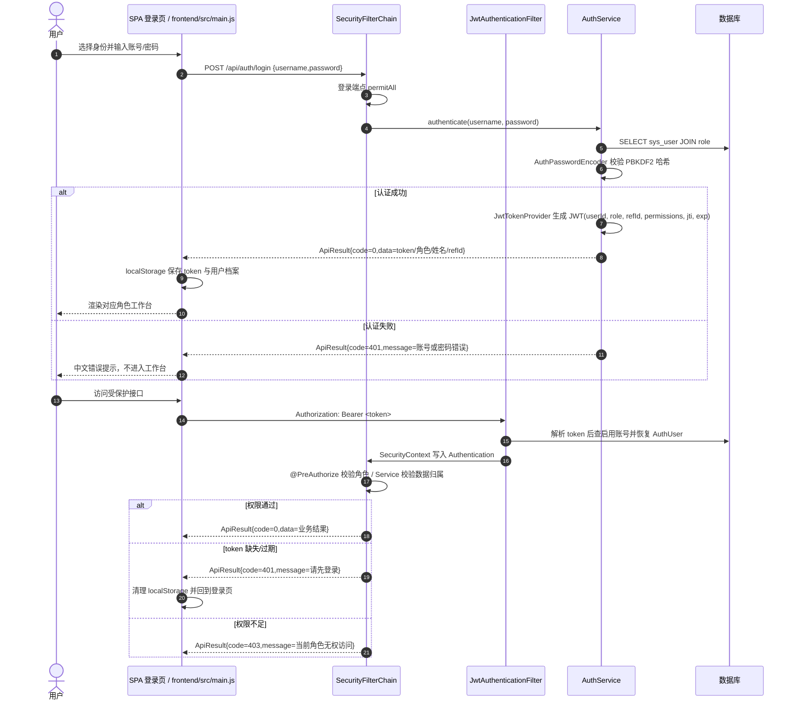

要点：

- JWT 无状态，服务端不保存 Session。
- 当前签发的 JWT 含 `jti` 与 720 分钟有效期；尚未实现 refresh token 与退出黑名单，退出登录以清除浏览器端 token 为准。
- `@PreAuthorize` 只做角色判断，细粒度权限仍由 Service 层校验，避免“医生 A 查询医生 B 的患者”这类水平越权。
- 登录端点、静态资源与 `/error` 放行；业务 `/api/**` 与 WebSocket 握手均需有效 JWT。

### 13.2 SD-09 WebSocket 实时叫号

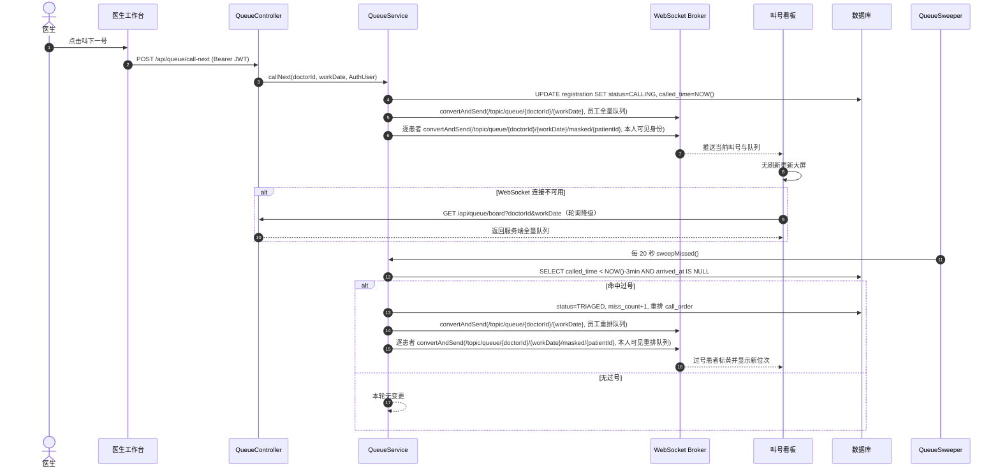

要点：

- WebSocket 只负责展示，不承担业务判定。
- 服务端定时扫描保证浏览器断线、WebSocket 丢失时，过号规则仍然生效。
- 前端通过 `GET /api/queue/board?doctorId=&workDate=` 拉取队列用于首屏、重连与断线降级；STOMP 握手 `/ws?token=<JWT>` 由服务端 ChannelInterceptor 校验并按医生、日期和角色授权。员工主题发送完整队列，患者专属主题按订阅者保留本人身份、抹去其他患者身份。

### 13.3 SD-10 库存锁定与发药 `[扩展设计]`

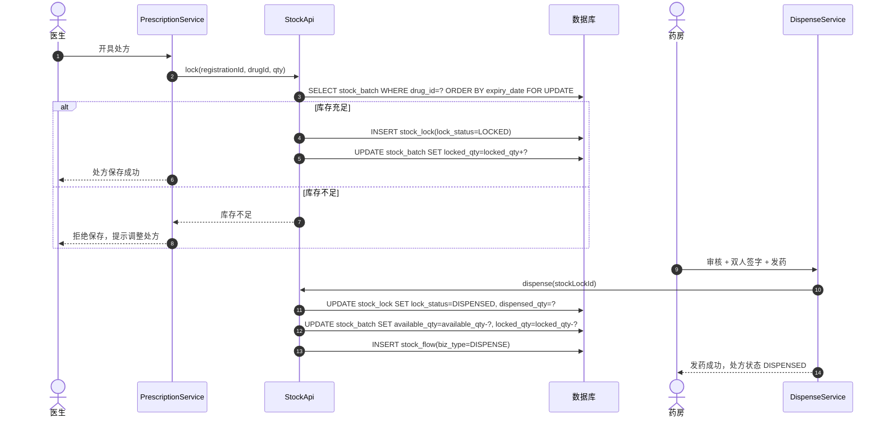

本节描述 `stock_batch / stock_lock / stock_flow` 的后续演进，当前代码尚未建立这些表。要点：

- 开方即锁库存，患者未缴费前药品不会被他人开走。
- 批次按 `expiry_date` 升序加锁，避免死锁。
- 发药、退药、释放锁定都通过数量列约束防止超扣。

### 13.4 SD-11 幂等挂号 `[扩展设计]`

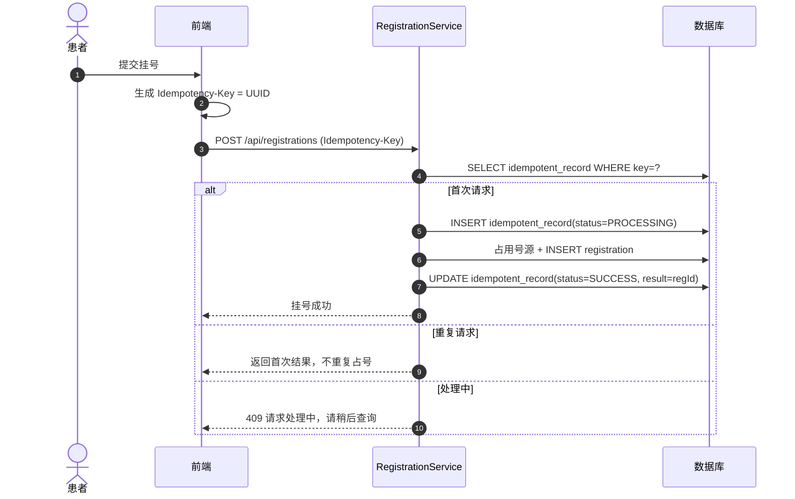

当前代码尚未实现 `idempotent_record` 与 `Idempotency-Key`；现有防重依靠状态机、号序唯一约束和有效挂号唯一索引。演进设计要点：

- `Idempotency-Key` 由客户端生成，服务端只负责持久化。
- 挂号、缴费、退费、医保结算均采用同一模式。
- 幂等记录保留 7 天，用于排查网络重试和重复点击。

### 13.5 SD-12 医保失败与原单重试

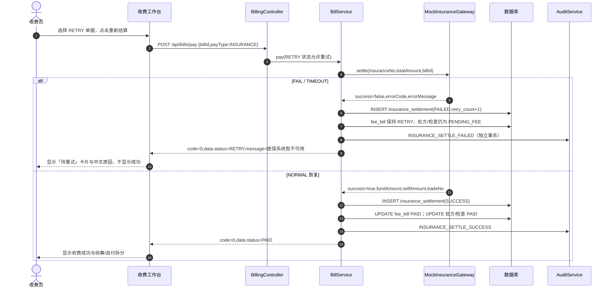

要点：医保失败响应可能仍是 HTTP 200 且 `code=0`，前端必须检查 `data.status`；BR-10 要求失败时绝不把收费单置为 `PAID`。模式切换通过 `app.insurance.mode` 完成，重试无需新建收费单。

### 13.6 SD-13 审计日志独立事务

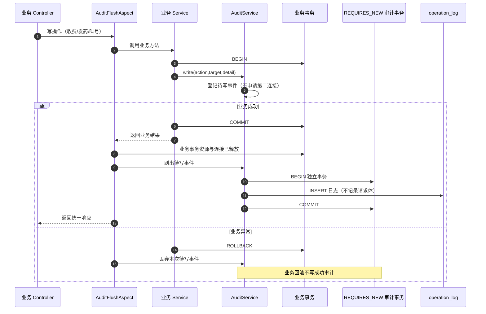

要点：`AuditService.write` 在业务事务中登记日志事件，外层 `AuditFlushAspect` 在业务事务资源与连接释放后调用 `Propagation.REQUIRES_NEW` 独立事务同步落库；这样既保留日志与业务事务解耦，又避免同一请求持有号源行锁时再申请第二条连接造成并发连接池饥饿。业务异常时丢弃待写事件，不写成功审计；审计失败不阻断已提交业务。日志只插入、不更新、不删除；当前日志与业务表同库，独立日志库为生产扩展。

### 13.7 SD-14 前端首屏、JWT 失效与看板降级

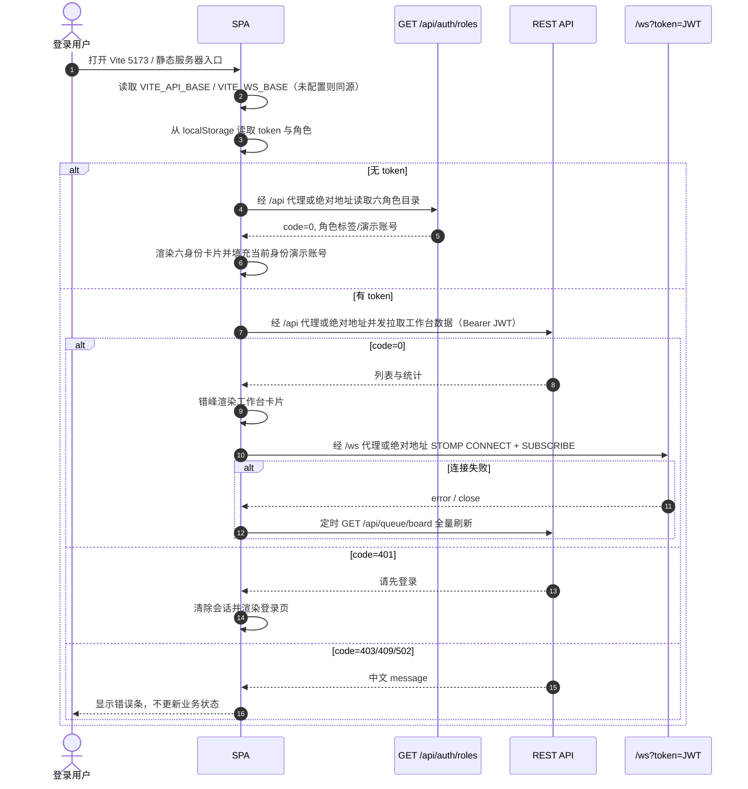

要点：页面加载动画只覆盖首屏；列表错峰出现；所有状态变化以服务端返回为准。身份目录是公开只读接口，用户手动编辑账号后不覆盖输入；服务端仍按登录账号真实角色签发 JWT。该图对应 PRD UI-01~UI-08 与 AC-19~AC-21。

V1.2 浏览器校核：CDP 在 1440px 桌面与 390px 移动宽度验证六角色工作台、真实表单登录、失效 token 回登录、金额/时间/中文状态、无横向溢出、无 JS exception 与 error/warning 日志；另在 `FAIL` 模式真实提交医保结算，验证 `RETRY`、结算失败流水、中文原因与重新结算入口，并逐一检查 390px 六工作台。证据见 `docs/images/ui-acceptance-report.json`、`ui-dynamic-acceptance-report.json` 及同目录截图。校核覆盖 SD-14 首屏、正常连接和 SD-12 失败分支；V1.4 的 SD-07/07A 取消/退号事务与越权拒绝已由 `scripts/registration-cancel-refund-check.mjs` 执行 PASS，报告见 `registration-cancel-refund-report.json`。WebSocket 断线轮询降级和其余端点 403 全量清单仍须按 SD-14 补交互验收，不得由静态截图替代。

V1.3 分离补充：首屏资源由 `frontend/` 的 Vite/静态服务器提供；REST 先走 `/api` 同源代理，生产可改用 `VITE_API_BASE`，STOMP 对应 `/ws` 代理或 `VITE_WS_BASE`。CORS 预检由后端白名单处理，浏览器不再从 Spring Boot 根路径加载 `index.html`。验收时应分别启动后端 8080 与前端 5173/4173，并确认 `GET http://127.0.0.1:8080/` 只返回 JSON 服务标识；详见《07-前后端分离架构与部署说明.md》。本轮已在 5173/5174/4173 复跑浏览器与代理验收，两份 UI 报告和 `frontend-split-acceptance-report.json` 均 PASS。

V1.4 取消/退号补充：患者台和收费台分别通过独立 SPA 的 `api()` 提交取消/退号；服务端返回 `RegistrationView` 后前端重拉工作台，队列看板由 STOMP 按角色订阅员工主题或患者脱敏主题接收刷新。验收脚本已覆盖合法取消、合法退号、终态重复操作、越权角色与号源余量/审计/退费记录一致性，机器可读结果 `docs/images/registration-cancel-refund-report.json` 为 PASS。

### 13.8 SD-15 管理员维护用户/角色与排班

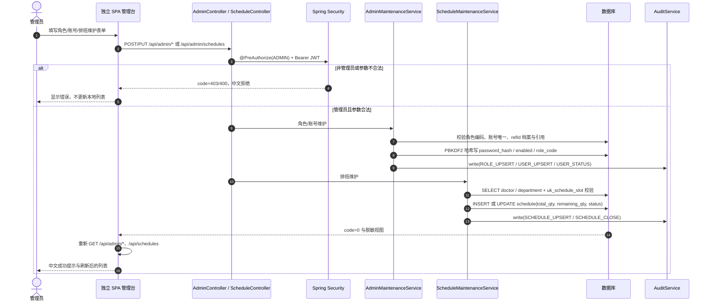

V1.5 实现口径：`/api/admin/**` 全部为 ADMIN 专属；账号视图不含 `password_hash`，口令新建/重置时用 `PasswordHasher.hash`。角色不提供删除；账号不提供物理删除，只提供启用/禁用；排班不提供物理删除，只提供 `CLOSED` 停诊。编辑号源总量时读取当前 `total_qty - remaining_qty` 作为占用数，`newRemaining=newTotal-used`；`newTotal < used` 或 `newRemaining < 0` 直接拒绝。验收脚本 `scripts/admin-maintenance-check.mjs` 覆盖新建角色、新建账号、改口令登录、禁用账号、新建/调整/停诊排班、非管理员 403、非法容量 409、审计留痕与演示数据清理，结果写入 `docs/images/admin-maintenance-report.json`。

2026-11-05 实测：SD-15 的维护端点、独立 SPA 表单和审计动作已执行 PASS，浏览器在 1440px 与 390px 检查三个维护表单、角色/账号/排班列表、中文状态与无异常日志；临时数据全部清理。截图为 `docs/images/admin-maintenance-desktop.png`、`admin-maintenance-forms-desktop.png`、`admin-maintenance-schedules-desktop.png`、`admin-maintenance-mobile.png` 与 `admin-maintenance-forms-mobile.png`。

V1.5.3 图集交付口径：本文 20 张时序图/状态图由 `scripts/export-mermaid-diagrams.mjs` 按图源原样导出到 `docs/images/diagrams/`，包括明确标注的 SD-10/11 扩展设计图；导出只增加可贴入报告的 SVG/PNG，不把扩展设计改写为已实现，也不改变时序与状态语义。

V1.5.4 压测口径：SD-01 的号源行锁与同事务号序读取是 50 并发压测的被测实现，压测脚本不绕过控制器、过滤器、事务或物理约束；具体采样与判定见 `docs/10-50并发性能压测说明.md`。

V1.6 数据归属补充：`BillService.detail(billId, AuthUser)` 在患者角色下核对 `fee_bill.patient_id` 与 JWT `refId`；`QueueService.board(...)` 对患者按「患者 + 医生 + 日期 + 有效挂号」授权并把非本人 `patientId/patientNo/patientName` 置空，对医生核对本人 `refId`；`QueueEventPublisher` 发布员工全量主题，并为每个候诊患者发布保留本人身份的专属脱敏主题；`QueueService.arrive(...)` 阻止医生确认他人队列；`StatsService.workload(...)` 对医生只保留本人就诊。以上由 `scripts/read-only-connectivity-audit.mjs` 实测，报告为 `docs/images/read-only-connectivity-report.json`。
