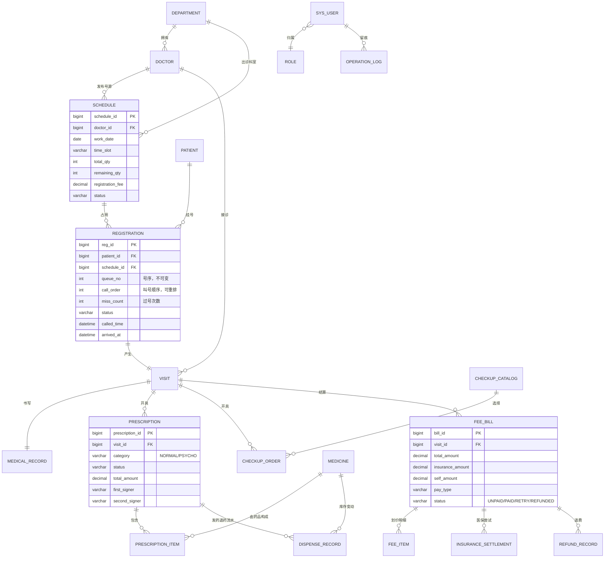

# 门诊挂号与就诊管理系统 · 数据库设计说明书

| 项目 | 内容 |
| --- | --- |
| 文档编号 | DBD-OUTP-001 |
| 版本 | V1.3（V1.7 审计口径与移植边界收口） |
| 上游文档 | 《01-产品需求文档PRD.md》V1.7、《02-概要设计说明书-SC结构图.md》V1.7、《03-详细设计说明书-SD时序图与状态图.md》V1.7 |
| 交付脚本 | `sql/mysql/01_schema.sql`、`sql/mysql/02_data.sql`；DM8 兼容性差异见本节移植方案，当前未提供 DM8 可执行脚本 |
| 对应实验 | 实验四 详细设计（数据库设计） |

## 1. 设计范围与基线

共 20 张业务表 + 3 个查询视图，字符集 `utf8mb4`，存储引擎 InnoDB（需要事务与外键）。数据模型沿用数据库课程设计（医务室门诊）的病人与药品库存基线，按题目四需求扩展出排班号源、挂号叫号、医保结算、审计日志四组对象。

命名约定：表名小写单数（视图以 `V_` 前缀大写），列名小写下划线，主键统一 `表名_id` 或业务编号，外键 `fk_子表_父表`，唯一键 `uk_表_语义`，检查约束 `chk_表_语义`。

## 2. 主题域划分

| 主题域 | 表 | 说明 |
| --- | --- | --- |
| 系统与权限 | role、sys_user、operation_log | 认证授权与审计 |
| 组织与人员 | department、doctor、patient | 科室、医生、患者档案 |
| 号源与挂号 | schedule、registration、refund_record | 排班、号源占用与退号 |
| 就诊与诊疗单据 | visit、medical_record、prescription、prescription_item、checkup_catalog、checkup_order | 一次就诊下挂病历、多张处方、多张检查单 |
| 费用与医保 | fee_bill、fee_item、insurance_settlement | 划价、收款、医保流水与重试 |
| 药房与库存 | medicine、dispense_record | 库存、发药与退药流水 |
| 视图 | V_QUEUE_BOARD、V_UNPAID_VISIT、V_MEDICINE_WARNING | 叫号看板、待收费、库存预警 |

## 3. ER 图



关系要点：
- `VISIT` 对 `PRESCRIPTION`、`CHECKUP_ORDER` 均为一对多，直接落实 BR-08。
- `SCHEDULE` 与 `REGISTRATION` 一对多，号源占用数 = 总量 − 余量，且同一 `(schedule_id, queue_no)` 唯一。
- `INSURANCE_SETTLEMENT` 对 `FEE_BILL` 多对一：一张收费单可以有多次医保尝试记录，`retry_count` 递增（BR-09）。
- `SYS_USER.ref_id` 是指向 doctor/patient 档案的业务引用，不建物理外键（多态引用），由服务层保证一致。

## 4. 表结构明细

### 4.1 role / sys_user

| 表 | 列 | 类型 | 约束 | 说明 |
| --- | --- | --- | --- | --- |
| role | role_code | VARCHAR(20) | PK，非空 | PATIENT/NURSE/DOCTOR/CASHIER/PHARMACIST/ADMIN |
| role | permissions | TEXT | NOT NULL | 权限编码逗号串 |
| sys_user | user_id | BIGINT | PK AI | |
| sys_user | username | VARCHAR(50) | UNIQUE NOT NULL | 登录账号 |
| sys_user | password_hash | VARCHAR(255) | NOT NULL | PBKDF2，禁止明文 |
| sys_user | role_code | VARCHAR(20) | FK→role | |
| sys_user | ref_id | BIGINT | NULL | 医生/患者档案主键 |

### 4.2 department / doctor / patient

| 表 | 关键列 | 约束 | 说明 |
| --- | --- | --- | --- |
| department | dept_id PK、dept_name UNIQUE、leader、location、phone_enc | PK/UNIQUE | 科室 |
| doctor | doctor_id PK、emp_no UNIQUE、name、title、dept_id FK、phone_enc | FK→department | 医生档案 |
| patient | patient_id PK、patient_no UNIQUE、name、gender、birth_date、id_card_enc、phone_enc、insurance_no、insurance_type | PK/UNIQUE、`chk_patient_gender` | 手机号与身份证加密（NFR-06） |

### 4.3 schedule（号源）

| 列 | 类型 | 约束 | 对应规则 |
| --- | --- | --- | --- |
| schedule_id | BIGINT | PK AI | |
| doctor_id / dept_id | BIGINT | FK | FR-01 |
| work_date / time_slot | DATE / VARCHAR(30) | `uk_schedule_slot(doctor_id, work_date, time_slot)` | BR-01 同一医生同一时段唯一排班 |
| total_qty / remaining_qty | INT | `chk_schedule_qty(remaining>=0 AND remaining<=total)` | BR-01 挂满即停、NFR-10 |
| registration_fee | DECIMAL(10,2) | NOT NULL | FR-19 计入划价 |
| status | VARCHAR(10) | OPEN/CLOSED | E-01 |

并发控制：占用与释放均在事务内 `SELECT ... FOR UPDATE` 锁行 + 条件更新（FR-04/BR-03）。

### 4.4 registration（挂号单）

| 列 | 类型 | 约束 | 说明 |
| --- | --- | --- | --- |
| reg_id | BIGINT | PK AI | |
| patient_id / schedule_id / doctor_id | BIGINT | FK | |
| queue_no | INT | `uk_reg_queue(schedule_id, queue_no)` | 号序，取号凭证，赋值后不变 |
| call_order | INT | NULL | 叫号顺序，护士维护、过号重排（FR-10/FR-12） |
| miss_count | INT | DEFAULT 0 | 累计过号次数 |
| status | VARCHAR(20) | `chk_reg_status` 七态 | FR-08 状态跟踪 |
| channel | VARCHAR(10) | ONLINE/KIOSK | FR-05 |
| reg_time / triage_time / called_time / arrived_at / end_time | DATETIME | | called_time 为 3 分钟判定基准（BR-04） |
| fee_paid | TINYINT(1) | | 挂号费是否已收，划价时生成来源明细 |
| active_schedule_id | BIGINT GENERATED ... STORED | `uk_patient_active_schedule(patient_id, active_schedule_id)` | `REGISTERED/TRIAGED` 时指向号源，其余状态为 NULL；取消或退号后自动释放唯一占用 |
| queue_version | INT | DEFAULT 0 | 队列重排乐观核对 |
| registration_fee | DECIMAL(10,2) | NOT NULL | 退号时写入 `refund_record.refund_amount` 的挂号费快照 |

索引：`idx_reg_doctor_status`、`idx_reg_patient`、`idx_reg_call`。

### 4.5 visit / medical_record

`visit.reg_id` UNIQUE（一次挂号只产生一次就诊）；`medical_record.visit_id` UNIQUE（一次就诊一份病历），主诉、诊断、医嘱三个必填/可填文本列，`update_time` 自动刷新。

### 4.6 prescription / prescription_item / medicine / dispense_record

| 表 | 关键约束 | 对应规则 |
| --- | --- | --- |
| prescription | `chk_presc_status` 六态；`chk_presc_cat` | BR-06/BR-07 |
| prescription_item | `fk_item_presc`、`fk_item_medicine`、`chk_item_qty>0` | NFR-09 |
| medicine | `chk_medicine_stock(stock_qty>=0)`、low_warn/high_warn/expiry_date | FR-26/FR-28 |
| dispense_record | `chk_dispense_type` DISPENSE/RETURN，含 second_signer | FR-25/FR-27 |

单价与名称在明细中做快照，保证历史处方金额不受调价影响（对应 FR-19 的可复核性）。

### 4.7 checkup_catalog / checkup_order

字典表 + 单据表结构，`checkup_order.item_code` 外键到字典，状态三态 PENDING_FEE/PAID/DONE，`result_text` 存放检查结果。

### 4.8 fee_bill / fee_item / insurance_settlement / refund_record

| 表 | 关键约束 | 说明 |
| --- | --- | --- |
| fee_bill | `chk_bill_status` 四态；金额四列（total/paid/self/insurance） | BR-12 实收校验 |
| fee_item | `chk_feeitem_type` 三类来源（PRESCRIPTION/CHECKUP/REGISTRATION） | FR-19 划价留痕，可逐条对账 |
| insurance_settlement | `fk_settle_bill`、`chk_settle_status`、trade_no、retry_count | BR-09/BR-10 |
| refund_record | `chk_refund_type`：`REGISTRATION` / `FEE` | FR-07/FR-22；退号记录 `bill_id=NULL`、`reg_id=挂号单ID`，收费单整单退费记录 `bill_id=收费单ID` |

约束检查：`total_amount = self_amount + insurance_amount` 由服务层在收款成功时断言并写入日志（医保拆分金额来自外部回传，不入库校验）。

V1.1 取消/退号事务口径：患者取消把 `status` 置 `CANCELLED`、写 `end_time` 与 `REGISTRATION_CANCEL` 审计，并回补 `schedule.remaining_qty`，不写 `refund_record`；收费员退号把 `status` 置 `REFUNDED`、清空队列顺位、写 `end_time`、回补号源，并插入 `refund_record(type=REGISTRATION, refund_amount=registration_fee)` 与 `REGISTRATION_REFUND` 审计。两类操作均先 `SELECT registration FOR UPDATE`，再 `SELECT schedule FOR UPDATE`，用 `chk_schedule_qty` 和状态终态拒绝重复回补；`uk_patient_active_schedule` 在状态离开 `REGISTERED/TRIAGED` 后允许同一患者重新挂取同一号源。退号端点与已收费收费单整单退费互不自动级联，避免同一挂号费重复退费；复合退费属于扩展设计。

V1.2 管理员维护口径：`role.role_code` 是稳定业务主键，`sys_user.role_code` 外键保证角色不被悬空引用；本系统不物理删除角色或账号，仅修改 `enabled` 做逻辑停用。`sys_user.password_hash` 只保存 `pbkdf2:sha256:...`，维护 REST 不读取、不回传该列；`username` 唯一，`PATIENT/DOCTOR` 账号的 `refId` 分别指向 `patient/doctor` 的有效主键。`schedule` 的 `uk_schedule_slot(doctor_id,work_date,time_slot)` 防重复排班，`chk_schedule_qty` 继续约束 `0 <= remaining_qty <= total_qty`；管理员调整 `total_qty` 时由服务层按 `used=total_qty-remaining_qty` 计算新余量，不允许 `newTotal < used`。已有挂号占用时服务层还禁止更换医生、科室、日期或时段，避免历史挂号单与号源错配。停诊只把 `status` 置 `CLOSED`，不删除排班和历史挂号单。角色/账号/排班写操作分别写 `ROLE_UPSERT`、`USER_UPSERT/USER_STATUS`、`SCHEDULE_UPSERT/SCHEDULE_CLOSE` 审计动作。上述约束已由 `admin-maintenance-report.json` 的 AC-24 PASS 验证，并保持物理外键不变。

AC-04 并发口径：`uk_reg_queue(schedule_id,queue_no)` 与 `uk_patient_active_schedule(patient_id,active_schedule_id)` 是最终防线，但不是分配号序的算法。服务层必须先以 `SELECT ... FOR UPDATE` 排它锁定 `schedule` 行，再在同一事务内用 `findByScheduleForUpdate(schedule)` 锁定该号源已有挂号单并计算 `MAX(queue_no)+1`；仅锁号源而使用普通快照读会导致并发请求重复计算号序，触发唯一键异常。`chk_schedule_qty` 保证 `0 <= remaining_qty <= total_qty`，最终由 20 并发抢 15 号源脚本验证号序 1~15、余量 0、无脏数据与夹具清理。

### 4.9 operation_log

| 列 | 用途 |
| --- | --- |
| operator_id / operator_name / operator_role | 谁做的 |
| action | CHARGE_PAY、DRUG_DISPENSE、INSURANCE_SETTLE_FAILED、REG_REFUND、QUEUE_MISS 等 |
| target_type / target_id | 对什么做 |
| detail | 关键参数与结果（金额、号序、失败原因） |
| client_ip / operate_time | 上下文 |

索引 `idx_log_action(action, operate_time)` 支撑审计查询（FR-32）。

## 5. 完整性约束对照

| 非功能需求 | 落地的 DDL 元素 | 数量 |
| --- | --- | --- |
| NFR-08 实体完整性 | 每表 PRIMARY KEY | 20/20 |
| NFR-09 参照完整性 | FOREIGN KEY 约束 | 24 处 |
| NFR-10 业务规则完整性 | UNIQUE 5 处 + CHECK 13 处 | 覆盖 BR-01/03/06/08/09 |
| NFR-12 事务性 | 号源占用、发药扣库存、收费与医保、处方保存四段使用 `@Transactional` | 4 个关键路径 |

## 6. 视图设计

| 视图 | 用途 | 关联表 |
| --- | --- | --- |
| V_QUEUE_BOARD | 叫号看板：当前叫号 + 候诊队列 + 过号标记 | registration、schedule、doctor、patient |
| V_UNPAID_VISIT | 待收费就诊与应收金额（处方 + 检查单汇总） | visit、prescription、checkup_order、patient、doctor |
| V_MEDICINE_WARNING | 库存低限/高限/近效期预警 | medicine |

视图只做读优化，不参与写操作，避免与业务层状态机产生双写歧义。

## 7. 性能与容量估算

| 表 | 年增长估算 | 索引策略 |
| --- | --- | --- |
| registration | 门诊量 20 万/年 | (doctor_id, status)、(patient_id, reg_time)、(schedule_id, queue_no) UNIQUE |
| prescription_item | 与处方同量级 ×3 | (prescription_id) |
| fee_bill / fee_item | 20 万 / 60 万 | (visit_id)、(cashier_id, pay_time) |
| operation_log | 关键操作约 100 万/年 | (action, operate_time)，按月归档 |

针对 NFR-01（关键响应 ≤3s）与 NFR-03（查询 ≤5s）：列表接口一律分页 + 覆盖索引；统计走视图或预聚合；`SELECT ... FOR UPDATE` 只锁单行号源，锁等待设 5 秒超时并回滚。

## 8. 达梦 DM8 迁移说明

实验一写的技术选型是达梦 DM8，本设计保持 ANSI 兼容以便切换：

| 差异点 | MySQL 写法 | 达梦写法 |
| --- | --- | --- |
| 自增主键 | `BIGINT AUTO_INCREMENT` | `BIGINT IDENTITY(1,1)` |
| 建库 | `CREATE DATABASE` | 达梦按模式（SCHEMA）划分，改为 `CREATE SCHEMA OUTPATIENT` |
| 注释 | 列内 `COMMENT` | 需改为 `COMMENT ON COLUMN`（DM8 支持列内 COMMENT 但建议统一） |
| 布尔 | `TINYINT(1)` | `BIT` 或 `NUMBER(1)` |
| 日期函数 | `CURDATE()`、`DATE_ADD` | `CURRENT_DATE`、`DATEADD(DAY,1,...)` |
| 引擎/字符集子句 | `ENGINE=InnoDB` | 删除 |
| 视图大小写 | 不敏感 | 未加引号时默认大写，脚本已按 `V_` 大写命名 |

上表为 DM8 移植方案，当前项目未交付 DM8 可执行迁移脚本；如启用达梦数据库，须按上表补写脚本并替换驱动、URL 与方言分页语句，不能把该表格表述为已交付迁移脚本。V1.7 不新增数据库表；`operation_log` 继续只插入不更新，登录用户动作写入真实 `operator_id/operator_name/operator_role`，定时任务使用 SYSTEM 身份。

## 9. 备份与恢复（NFR-11）

- 每日 02:00 全量：`mysqldump --single-transaction --routines --triggers outpatient > backup_$(date).sql`
- 每小时增量：基于 binlog 位点归档。
- 恢复演练：交付时提供一次「删表 → 全量 + 增量回放 → 行数比对」的记录，作为验收材料。

## 10. 演示数据基线

`02_data.sql` 提供：科室 5、医生 5、患者 8、药品 12（含 3 种精神类）、检查项目 8、号源 10（今明后三天）、挂号单 6（覆盖 REGISTERED/TRIAGED/CALLING/VISITED/MISSED 五种状态）、1 条完整就诊链（病历 + 处方 + 2 张检查单 + 医保收费单 + 发药流水）、15 个演示账号（口令统一 `123456`，PBKDF2 存储）。

敏感字段以 `PLAIN:` 前缀入库，应用首次启动时由 `SeedCipherMigrator` 统一加密回写，验收时可直接 `SELECT phone_enc FROM patient` 观察密文。

## 11. 借鉴开源项目后的数据库增强

本节落实《06-GitHub借鉴与选型说明.md》中需要新增或调整的表结构。

### 11.1 敏感字段盲索引

在 `patient` 表增加两列，用于唯一约束和精确检索：

| 列 | 类型 | 约束 | 说明 |
| --- | --- | --- | --- |
| phone_hash | CHAR(64) | `KEY idx_patient_phone(phone_hash)` | 手机号 HMAC-SHA256 盲索引 |
| id_card_hash | CHAR(64) | `UNIQUE KEY uk_patient_id_card(id_card_hash)` | 身份证号 HMAC-SHA256 盲索引 |

`phone_enc` 与 `id_card_enc` 建议由 `VARCHAR` 改为 `VARBINARY(128)`，配合 AES-GCM 密文格式。

### 11.2 price_item 价格版本表

新增 `price_item` 表，用于挂号、检查、药品的版本化定价：

| 列 | 类型 | 约束 |
| --- | --- | --- |
| id | BIGINT | PK |
| item_code | VARCHAR(32) | NOT NULL，索引 |
| item_name | VARCHAR(100) | NOT NULL |
| item_type | TINYINT | 1挂号 2药品 3检查 |
| unit_price | DECIMAL(12,2) | CHECK >= 0 |
| insurance_ratio | DECIMAL(5,4) | 0~1 |
| effective_from | DATETIME | NOT NULL |
| effective_to | DATETIME | NULL |
| created_at / updated_at | DATETIME | 审计 |

唯一约束：`(item_code, effective_from)`。

### 11.3 stock_batch / stock_lock / stock_flow

| 表 | 作用 | 关键列 |
| --- | --- | --- |
| stock_batch | 药品批次库存 | `drug_id`, `batch_no`, `expiry_date`, `available_qty`, `locked_qty` |
| stock_lock | 开方锁定 | `registration_id`, `prescription_item_id`, `stock_batch_id`, `qty`, `status` |
| stock_flow | 出入库流水 | `biz_type`, `biz_no`, `stock_batch_id`, `qty`, `created_at` |

状态约束：

- `stock_batch.available_qty >= 0`
- `stock_batch.locked_qty >= 0`
- `stock_lock.qty >= 0`
- `stock_flow.qty > 0`

开方时写入 `stock_lock` 并增加 `locked_qty`；发药时扣减 `available_qty` 并释放 `locked_qty`；退药时回补 `available_qty`。

### 11.4 idempotent_record

新增 `idempotent_record` 表，用于挂号、缴费、退费、医保结算的幂等控制：

| 列 | 类型 | 约束 |
| --- | --- | --- |
| id | BIGINT | PK |
| idempotency_key | VARCHAR(64) | UNIQUE |
| biz_type | VARCHAR(30) | REGISTRATION / PAY / REFUND / INSURANCE |
| request_hash | CHAR(64) | NOT NULL |
| status | TINYINT | 0处理中 1成功 2失败 |
| result | JSON | NULL |
| created_at | DATETIME | NOT NULL |
| updated_at | DATETIME | NOT NULL |

保留策略：7 天后归档或删除。

### 11.5 audit_log 独立化

生产环境建议将 `operation_log` 拆到独立数据库 `outpatient_audit`：

```sql
CREATE DATABASE outpatient_audit;
GRANT INSERT, SELECT ON outpatient_audit.* TO 'outpatient_app';
-- 不授予 UPDATE、DELETE
```

课程演示环境可继续使用同库的 `operation_log` 表，但服务层仍按“独立事务、只插入、不更新”的方式实现。

V1.7 审计口径：`REGISTRATION_BOOK`、`QUEUE_REPORT`、`QUEUE_ARRIVE`、`QUEUE_MISS`、`BILL_PRICE` 等关键动作均须有可追溯操作人或 SYSTEM 身份；业务事务只登记待写事件，外层 `AuditFlushAspect` 在业务事务释放连接后调用 `AuditService` 的 `REQUIRES_NEW` 独立事务同步落库，避免持号源行锁时同时占用第二条连接造成并发连接池饥饿；独立事务不等同业务与日志同事务原子一致，业务异常不写成功审计。

V1.5.3 图集交付口径：本文 `## 3. ER 图` 的 Mermaid 图源纳入全量导出，输出 `ER-全局` 对应 SVG/PNG；导出文件只用于报告排版，不替代 `sql/mysql/01_schema.sql` 中的物理表、外键与约束定义。

V1.5.4 压测口径：AC-26 保留 `uk_reg_queue`、`uk_patient_active_schedule`、`chk_schedule_qty` 与物理外键，不关闭约束、不清空演示表或临时改索引；临时号源、患者与账号由 `finally` 清理，物理约束仍是最终一致性防线。
