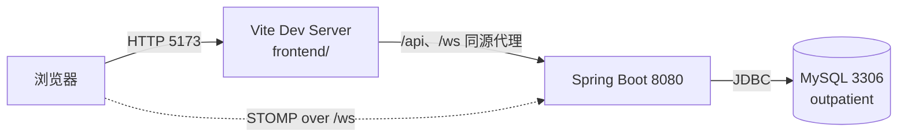
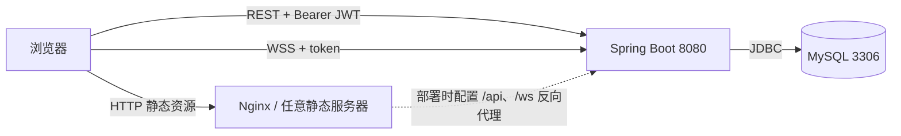

# 前后端分离架构与部署说明

| 项目 | 内容 |
| --- | --- |
| 文档编号 | DEP-OUTP-001 |
| 版本 | V1.7（独立部署配置、管理员维护、全量图集、50 并发 P95、业务连通性与 WS/审计/文档基线复验） |
| 上游文档 | PRD V1.7、SC V1.7、SD V1.7、DBD V1.3、GitHub 借鉴 V1.8、用户手册 V1.5、图集记录 V1.2、压测说明 V1.2、连通性审计 V1.2 |
| 对应实验 | 实验三 概要设计 / 实验八 部署与验收 |
| 状态 | 已按独立前端工程实现，并通过分离联调复核 |

## 1. 分离边界

| 层 | 目录/进程 | 职责 | 禁止事项 |
| --- | --- | --- | --- |
| 浏览器 SPA | `frontend/`，开发端口 `5173` | 登录、六角色工作台、JWT 本地保存、REST 调用、STOMP 订阅、轮询降级 | 不得直连 MySQL，不得自行裁定业务状态 |
| BFF/API | Spring Boot `8080` | JWT 鉴权、角色授权、业务事务、统一 `{code,message,data}`、WebSocket Broker、审计 | 不再托管业务 SPA 静态文件 |
| 数据层 | MySQL `3306` | 20 张业务表、3 视图、外键/唯一约束 | 不向浏览器暴露连接信息 |

开发运行时：

生产/演示运行时：

## 2. 前端工程约定

- `frontend/index.html`、`frontend/src/main.js`、`frontend/src/styles.css` 是 SPA 源。
- `frontend/vite.config.js` 将 `/api` 与 `/ws` 代理到 `http://127.0.0.1:8080`；开发时浏览器保持同源，不依赖宽松 CORS。
- `frontend/src/config.js` 用 `import.meta.env.VITE_API_BASE` / `VITE_WS_BASE` 支持生产绝对地址；未配置时沿用同源路径 `/api`、`/ws`。
- `frontend/src/main.js` 使用 ES module，替代迁移前 Spring Boot `src/main/resources/static/app.js` 的全局脚本；当前运行时只使用独立前端工程。
- `npm run dev` 开发；`npm run build` 输出到 `frontend/dist/`；`npm run preview -- --host 127.0.0.1 --port 4173` 预览构建产物。
- 构建产物不由 Maven 复制进 `target/classes/static`，后端 jar 只含 REST/JWT/WebSocket 与 Java 资源。

## 3. 后端接口约定

- `app.cors.allowed-origins` 配置精确允许的前端源，默认含 `5173/5174` 开发端口与 `4173/4174` 预览端口；FAIL 模式联调使用 5174。
- `/api/auth/login`、`/api/auth/roles` 公开；其余 `/api/**` 仍要求 Bearer JWT；`/error` 公开用于统一错误体。
- CORS 允许 `Authorization`、`Content-Type`、`Accept` 请求头和 `OPTIONS` 预检；不携带 Cookie，不使用 `allowCredentials=true`。
- WebSocket `/ws` 的 `setAllowedOriginPatterns` 由配置注入，不再无条件写 `*`；Vite WS 代理通过 `VITE_BACKEND_ORIGIN` 显式设置白名单内的 Origin，避免代理默认 Origin 被后端拒绝。
- Spring Boot 根路径不再提供业务登录页；访问 `/` 返回 JSON 服务标识，避免「后端仍在托管旧 SPA」的歧义。
- 静态资源 URL 从迁移前的 `/index.html`、`/styles.css`、`/app.js` 改为 Vite 输出的带哈希资源；旧 `src/main/resources/static/` 已移出项目，只在 `C:\Users\27685\mysql-outpatient\outpatient-frontend-split-snapshot\static-active\` 留作快照。
- V1.1 新增两个纯 API 端点：患者本人 `POST /api/registrations/{id}/cancel`、收费员 `POST /api/registrations/{id}/refund`；响应仍为 `RegistrationView`，前端只做展示与刷新，状态/号源/退费/审计由后端单事务保证。
- V1.2 新增 `/api/admin/roles`、`/api/admin/users`、`/api/admin/schedules` 维护端点，全部 `ADMIN` 专属；管理台表单仅在独立 SPA 提交，角色/账号/排班与审计由 Spring Boot 事务保证，密码哈希与容量校验不暴露给浏览器。

## 4. 验收口径

1. `mvn -q -DskipTests package` 通过；`GET http://127.0.0.1:8080/` 返回 JSON 服务标识而非 HTML。
2. `npm run dev` 后通过 `http://127.0.0.1:5173/api/auth/roles` 得到 `code=0` 六个角色；登录六个演示账号均成功。
3. 六角色桌面工作台、390px 六工作台、失效 token 回登录、医保 FAIL 待重试仍在独立前端通过；STOMP 状态为「实时队列已连接」。
4. `npm run build` 通过，`frontend/dist/` 含 `index.html` 与 `assets/`；预览端口 4173 可加载 SPA 且 `/api` 可由反向代理配置送达后端。
5. CORS 非白名单源被拒绝；白名单源 `OPTIONS` 预检通过。

## 4.1 独立部署配置

`deploy/nginx.conf.example` 是同源反向代理参考配置：Nginx 直接托管 `frontend/dist/`，把 `/api/` 代理到 Spring Boot `8080`，并把 `/ws` 以 WebSocket Upgrade 代理到同一后端。把示例中的 `root` 改成实际构建产物绝对路径，在 `nginx.conf` 的 `http {}` 中 include 后即可 `nginx -t && nginx -s reload`。同源部署不依赖 CORS；若把 SPA 与 API 拆到不同域名，构建前设置 `VITE_API_BASE=https://api.example.com/api`、`VITE_WS_BASE=wss://api.example.com`，并把前端源加入 `app.cors.allowed-origins`。

## 4.2 项目内验收命令

验收脚本已迁入 `scripts/`，不依赖临时目录：`npm run check:ui` 做登录/失效 token/六角色桌面与 390px 验收；`npm run check:dynamic` 做医保 FAIL 与 390px 六工作台动态验收；`npm run check:registration` 做取消/退号事务、越权与审计一致性验收；`npm run check:admin` 做角色/账号/排班维护、口令哈希、403/409 与审计一致性验收；`npm run check:connectivity` 做六角色业务连通性、患者脱敏与数据归属只读审计；`npm run check:concurrency` 做 20 并发抢 15 号源、号序与余量一致性验收；`npm run check:perf` 做 3 轮 50 并发挂号 P95 压测；`npm run check:mermaid` 校验 01~08 文档全部 Mermaid 图源；`npm run check:diagrams` 逐张导出 SVG/PNG 并写图集索引；`npm run check:ws` 做 STOMP 主题授权与广播脱敏验收；`npm run check:audit` 做关键操作审计完整性；`npm run check:docs` 做文档/报告基线一致性。运行前分别启动后端 8080、独立前端 5173、FAIL 后端 8081、FAIL 前端 5174，以及带 `--remote-debugging-port=9225` 的 Edge/Chromium CDP；图集命令只需 CDP 和本地文档；`check:perf` 只需 8080 与 MySQL。报告输出到 `docs/images/`。脚本用环境变量 `UI_BASE`、`UI_CDP_PORT`、`UI_OUT_DIR`、`API_BASE`、`MYSQL_BIN` 与 `MERMAID_CDP_PORT` 覆盖默认端口和路径。六角色演示与排障操作见 `docs/08-用户手册.md`，图集规则见 `docs/09-图集导出与演示记录.md`，压测口径见 `docs/10-50并发性能压测说明.md`，连通性审计见 `docs/11-业务连通性与真实功能审计.md`。

## 4.3 联调结果（2026-11-06 V1.7 最终复核）

- 后端 `mvn clean package` PASS；`GET /` 返回 `application/json` 服务标识；`target/classes/static` 不存在。
- 前端 `npm install`、`npm run build` PASS；`frontend/dist/` 输出带哈希 CSS/JS；`npm run preview` 的 4173 端口与 `/api` 代理返回 `code=0`。
- 主链路：Vite 5173 → Spring Boot 8080；FAIL 模式链路：Vite 5174 → Spring Boot 8081（`app.insurance.mode=FAIL`）。
- 白名单 `http://127.0.0.1:5174` 的 `OPTIONS` 预检为 200 且返回对应 `Access-Control-Allow-Origin`；`http://evil.example` 为 403 且无该响应头。
- 浏览器静态验收与动态验收均 PASS：六角色桌面台、390px 六工作台、真实表单登录、失效 token 回登录、医保 FAIL 待重试、STOMP 实时连接；无 JS exception、无 error/warning 日志。
- 33 张 Mermaid 图解析 PASS（V1.5.3 起全量图集，V1.7 复核仍为 33 张）。机器可读汇总是 `docs/images/frontend-split-acceptance-report.json`，详细 DOM/截图证据仍见 `ui-acceptance-report.json` 与 `ui-dynamic-acceptance-report.json`。
- V1.1 动态验收已加强为「收费单重置为 UNPAID → 浏览器实际点击医保结算 → 新增唯一 FAILED 流水 → RETRY → 还原一条演示流水」，`ui-dynamic-acceptance-report.json` PASS；取消/退号事务、403 越权、409 终态重复与清理结果见 `docs/images/registration-cancel-refund-report.json`，PASS。`@PreAuthorize` 的拒绝统一为 `code=403` 中文响应，不再落到 500。
- V1.2 管理员维护验收见 `docs/images/admin-maintenance-report.json`：已实际运行 `npm run check:admin`，报告 `passed=true`；独立 SPA 管理台在 1440px/390px 可见角色/账号/排班表单，API 层验证新建账号登录、禁用账号、排班容量/停诊、口令哈希、403 越权、409 非法容量、审计与临时数据零残留。维护区域截图为 `admin-maintenance-forms-desktop.png`、`admin-maintenance-schedules-desktop.png` 与 `admin-maintenance-forms-mobile.png`。静态 UI、FAIL 动态 UI、取消/退号事务、管理员维护与 33 张 Mermaid 图的本轮重跑结果均为 PASS。
- V1.5.2 并发验收见 `docs/images/concurrency-acceptance-report.json`：20 个独立患者同时抢 15 个号源，成功 15 次、号序 1~15 无重复、余量归零、其余 5 次返回「号源已挂满，请重新选择」，临时患者/账号/号源/挂号/审计零残留。修复点为 `RegistrationService.book` 在号源行锁后改用同事务 `findByScheduleForUpdate` 读取当前号序。该报告覆盖 AC-04 正确性，不等同 50 并发 P95/10 万数据性能压测。
- V1.5.3 全量图集验收见 `docs/images/mermaid-export-report.json`，实际执行 PASS：`check:mermaid` 从 30 张扩为 33 张全量解析且失败 0；`check:diagrams` 生成 33 份 SVG、33 份 PNG、`图集索引.md` 与机器报告，`passed=true`。该命令不启动后端/前端，也不改动数据库，只处理设计文档图源。
- V1.5 连通性审计见 `docs/images/read-only-connectivity-report.json`，实际执行 PASS：独立 SPA 代理登录、六角色主要接口、统计/审计接口均为 `code=0`；患者越权读取、未挂号队列、其他医生队列与医生越权到诊均返回 `code=403`；患者队列其他候诊者身份为空，医生工作量只含本人。该脚本只读业务表，不创建挂号或收费数据。
- V1.7 新增 `npm run check:ws` / `npm run check:audit` / `npm run check:docs`：覆盖患者专属主题订阅、员工完整主题拒绝、广播订阅级脱敏、关键审计动作与文档基线一致性；报告分别为 `ws-authorization-report.json`、`audit-integrity-report.json`、`docs-baseline-report.json`。审计实现为业务事务登记待刷出，外层切面在业务事务资源释放后调用 `REQUIRES_NEW` 写入，避免并发时占用第二条业务连接。
- V1.7 50 并发 P95 压测见 `docs/images/perf-50-concurrency-report.json`，实际执行 PASS：3 轮共 150 次挂号全部成功，单轮 P95 705/549/525ms、汇总 P95 642ms、P99 719ms、最大 732ms，均 ≤ 3000ms；每轮号序 1~50、余量归零、无 5xx，临时夹具零残留。该报告不等同 10 万数据量、收费接口或生产容量压测。

## 5. 已知边界

- 本地开发用 Vite 代理解决同源；独立部署按 `deploy/nginx.conf.example` 为 `/api`、`/ws` 配置反向代理，或设置 `VITE_API_BASE` / `VITE_WS_BASE` 并开放相应 CORS/WS 源。
- JWT 仍保存在浏览器 localStorage，退出即清理；refresh token 黑名单、HttpOnly Cookie 方案属于后续安全扩展。
- V1.0 只改变交付拓扑与资源托管位置；V1.1 在既有分离边界内补齐 FR-06/FR-07 的取消/退号端点，其余 G-xx 缺口仍按 RTM 执行。
